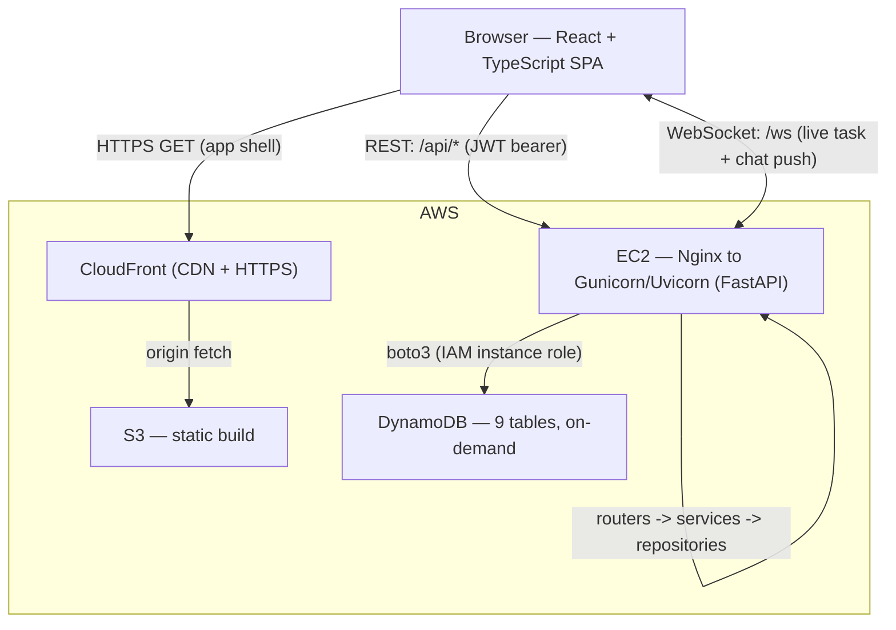

# Algo PM (Aksha PM) — Technical Design Document

**Project management platform — architecture, data model, API design, and what's shipped vs. the original plan**
AlgoAnalytics Pvt. Ltd. — Internal Tool
Version 2.2 · August 2026 (supersedes v2.1 · August 2026, which superseded v2.0, which superseded v1.0 · July 2026)

---

## 1. What changed since v1.0

v1.0 was the Phase-1 plan written before a line of code existed. The app has since grown well past that plan — this section is the delta.

| Area | v1.0 plan | What's actually built |
|---|---|---|
| Roles | Admin, Manager, Member | **Admin, Manager, Member** — Admin is the top role, with org-wide visibility plus two reporting dashboards (a short-lived "Executive" tier that outranked Admin was added and then removed; Admin absorbed its rights) |
| Task status | `todo \| in_progress \| in_review \| done \| blocked` | `backlog \| todo \| in_progress \| blocked \| hold \| done` (no `in_review`; added `backlog` and `hold`) |
| Methodology | Kanban only | **Kanban or Scrum per project** — Scrum adds a Backlog + time-boxed Sprints on top of the same task model |
| Task lifecycle | Create → update → delete | Create → update → **soft-delete (5-day trash) → permanent delete**, plus a separate **archive** path — three distinct end states, not one |
| Subtasks | Embedded list on the task | **Own entity** (`Subtask`), independently assignable, own priority/dates |
| Chat | Yes (per-project, per-task threads) | Built as planned, plus **Notes** (a separate running list of written points per task, distinct from the chat thread) |
| Personal productivity | Not in scope | **Personal Dashboard**: private per-user tasks, Eisenhower matrix, Pomodoro timer, reminders — separate from any project |
| Organization | Projects only | **Spaces** added above Projects (a Space groups related Projects) |
| Reporting | Not in scope | **Performance Review** (completions/month/member, due-date-move count) and **Projects Completed** (days-to-complete) — both Admin-only |
| Audit trail | Not in scope | Every due-date change on a Task or Project is recorded (`old_due_date`, `new_due_date`, `changed_by`, `changed_at`) |
| DB tables | 4 (Users, Projects, Tasks, Messages) | **9** — see §5 |
| Branding | Generic | Rebranded to AlgoAnalytics: real logo assets, brand navy theme, redesigned login page |
| Project lifecycle | Create → update → delete | Create → update → **archive/reactivate** (toggle from the dashboard) → optional **permanent delete** (Admin-only, cascades through every task/subtask/note/sprint/message under it) |
| Space lifecycle | Not in scope | Spaces can be **deleted** — cascades to permanently delete every project filed under it (and everything under those projects), same as the project-level permanent delete. Requires typing the space's name to confirm |
| Sprint lifecycle | Start / Complete as two separate actions | Added **"Complete & start next"** — ends the active sprint and starts the next planned one in one call; a days-remaining countdown and an "ending soon" banner on the Backlog page |
| User lifecycle | No delete existed | Admin can **permanently delete a user** — every task assigned to them (any project) is unassigned rather than left dangling, every project membership is removed, every personal task they own is deleted |
| Project membership | Add only, no remove | Manager+ can now **remove a member** from a project (Manager-role members included) — only the Owner can't be removed this way |

*The last two rows were added after v2.1 was written — this is the v2.1 → v2.2 delta. The three rows above them were the v2.0 → v2.1 delta.*

## 2. Overview

Aksha PM is AlgoAnalytics' internal project management tool: task management, per-task/per-project chat and notes, project workspaces grouped into Spaces, an optional Scrum layer (backlog/sprints), a personal productivity dashboard, and Admin-only reporting. Realtime updates (task changes, chat) are pushed over a single shared WebSocket rather than polled.

### 2.1 Core capabilities (current)

- **Task management** — create, assign, and track tasks through status (Backlog → To do → In progress → Blocked/Hold → Done), with priority, start/due dates, labels, technologies, and subtasks.
- **Scrum layer** — per-project opt-in; adds a Backlog and Sprints (planned → active → completed), with drag-and-drop between Backlog and any Sprint. The Backlog page shows the active sprint's dates and a days-remaining countdown at the top, an "ending soon" banner once it's within 2 days of its end date (or overdue), and a one-click **"Complete & start next"** action that ends the current sprint and starts the next planned one together. Sprints list in scrum order — Active first, then Planned — not creation order.
- **Task lifecycle** — soft-delete (5-day recoverable trash) and archive (indefinite, reversible) are separate concepts, both with a permission-gated permanent-delete escape hatch.
- **Project lifecycle** — "Mark project complete" / "Reactivate" toggle on the Project Dashboard (archives/reactivates via the existing status field), plus a genuine **permanent delete** (Admin-only) that cascades through every task, subtask, note, sprint, and chat thread filed under the project.
- **Space lifecycle** — a Space can be deleted from the Spaces list; this permanently deletes every project filed under it, and everything under those projects, so it requires typing the space's exact name to confirm before it fires.
- **Due-date audit trail** — every actual change to a task's or project's due date is appended to a history list, timestamped and attributed to the user who made it.
- **Team chat & notes** — one chat thread per project and per task; Notes are a separate, persistent running list of written points on a task.
- **Spaces & Projects** — Spaces group related Projects; Projects group Tasks and have their own progress dashboard.
- **Personal Dashboard** — private per-user tasks scored on an Eisenhower urgent/important matrix, a Pomodoro timer, and due-date reminders — independent of any project.
- **Admin reporting** — Performance Review (tasks completed per member per month, by year, plus how often each member's due dates slipped) and Projects Completed (every project archived in a given year, with days-to-complete).
- **Role-based access** — Admin > Manager > Member (org-wide role) plus a separate per-project role (Owner/CoOwner/Manager/Member) for project-scoped permissions. Project-scoped actions (sprint start/complete, project archive) gate on the caller's actual role *on that project*, not their global role.
- **User deletion** — Admin can permanently delete a user account. This never deletes their tasks: every task assigned to them (across every project, found via the AssigneeIndex GSI) is unassigned back to "Unassigned," not removed. Every project membership they held is dropped, and every personal task they owned is deleted (those are private and meaningless without the owner). Both the profile row and the email-uniqueness lock are removed, so the email becomes registrable again.
- **Project membership management** — a project Manager+ (Manager-role project members included, not just Owner/CoOwner) can remove another member from the project. The Owner can't be removed this way — a project always needs one.

### 2.2 Recent fixes (not new features, but worth recording)

- **Sprint action gating bug** — the "Complete sprint" button was shown/hidden based on the caller's *global* role, which could show it to someone without the actual project-scoped Manager+ role the backend requires (or hide it from someone who did have it). Now checks the real per-project role, matching the backend exactly.
- **Task/Space board horizontal overflow** — the kanban board (and the Space board's aggregated view) had no scroll container of its own; on a narrow viewport the *whole page* scrolled sideways, dragging the sidebar along with it. Both boards now scroll within their own contained region.
- **Modal spacing** — every modal (Create Task/Project/Space, Edit Technologies, Promote Task, Password Prompt) gained more breathing room between fields and a visual divider before the action buttons, via the shared `.field`/`.modal__body`/`.modal__actions` classes.

## 3. Tech Stack

| Layer | Choice | Notes |
|---|---|---|
| Frontend | React 18 + TypeScript | SPA, built with Vite |
| Backend API | Python 3.12 + FastAPI | REST API + WebSocket endpoint in the same ASGI app |
| Data layer | boto3 + Pydantic models | Typed request/response schemas, validated at the API boundary |
| Realtime | FastAPI/Starlette WebSocket | Live task updates and chat delivery, no polling |
| Database | Amazon DynamoDB | On-demand capacity; one table per entity (9 tables) |
| Auth | JWT (access + refresh token) | Role embedded in token claims |
| Frontend hosting | Amazon S3 + CloudFront | Static build served globally over HTTPS |
| Backend hosting | Amazon EC2 | Nginx reverse proxy + Gunicorn/Uvicorn workers |
| Local dev | DynamoDB Local (Docker) | In-memory container on port 8010; a second instance on 9999 backs the pytest suite via mocked repos |

## 4. Current File & Folder Structure

### 4.1 Backend — `backend/app/`

```
app/
├── main.py                       # FastAPI() app, router registration, startup/shutdown
├── core/
│   ├── config.py                 # Settings (env vars, table names, JWT secret)
│   ├── security.py                # JWT create/verify, password hashing
│   └── deps.py                    # get_current_user, require_role(), require_project_role(),
│                                   # require_project_membership, repo providers
├── db/
│   ├── dynamo.py                  # boto3 resource/client, table handles
│   └── repositories/
│       ├── users_repo.py
│       ├── projects_repo.py
│       ├── tasks_repo.py
│       ├── subtasks_repo.py
│       ├── messages_repo.py
│       ├── notes_repo.py
│       ├── spaces_repo.py
│       ├── sprints_repo.py
│       └── personal_tasks_repo.py
├── models/                        # Pydantic domain models
│   ├── user.py | project.py | task.py | subtask.py | message.py
├── schemas/                       # Request/response DTOs
│   ├── user_schemas.py | project_schemas.py | task_schemas.py
│   ├── subtask_schemas.py | message_schemas.py | note_schemas.py
│   ├── space_schemas.py | sprint_schemas.py | personal_task_schemas.py
│   ├── stats_schemas.py           # Performance review / projects-completed DTOs
│   └── common_schemas.py          # DueDateChange (shared by Task + Project)
├── routers/                       # APIRouter per resource (see §6 for routes)
│   ├── auth.py | users.py | projects.py | tasks.py | subtasks.py
│   ├── messages.py | notes.py | spaces.py | sprints.py
│   ├── personal_tasks.py | stats.py
├── services/                      # Business logic, called by routers
│   ├── auth_service.py | project_service.py | task_service.py | subtask_service.py
│   ├── message_service.py | note_service.py | space_service.py
│   ├── sprint_service.py | personal_task_service.py | user_service.py
└── ws/
    └── connection_manager.py       # WebSocket connection registry + broadcast

tests/            # One test module per router/service, 129 tests total
scripts/          # create_tables.py, seed_mock_data.py, seed_performance_data.py,
                  # seed_overdue_and_due_date_moves.py, seed_admin.py, seed_scrum_demo.py
```

### 4.2 Frontend — `frontend/src/`

```
src/
├── main.tsx / App.tsx              # Routes, RequireAuth / RequireAdmin guards
├── api/                            # One module per resource — thin fetch wrappers
│   ├── client.ts                   # axios instance, JWT interceptor, camelCase<->snake_case
│   ├── users.ts | projects.ts | tasks.ts | subtasks.ts | messages.ts
│   ├── notes.ts | spaces.ts | sprints.ts | personalTasks.ts | stats.ts
├── types/index.ts                  # Shared TS interfaces, mirrors backend schemas
├── store/authStore.ts              # Zustand: user, accessToken, isBootstrapping
├── hooks/                          # One hook per resource + a few cross-cutting ones
│   ├── useAuth.ts | useProjects.ts | useTasks.ts | useSubtasks.ts | useNotes.ts
│   ├── useSprints.ts | useSpaces.ts | usePersonalTasks.ts
│   ├── useMyTasks.ts | useOrgTasks.ts | useOrgMemberNames.ts | useProjectMembers.ts
│   ├── useDeletedTasks.ts | useArchivedTasks.ts | useChatSocket.ts
│   ├── useTaskEvents.ts | useReminderNotifications.ts
├── pages/
│   ├── Login.tsx | Dashboard.tsx
│   ├── SpaceList.tsx | SpaceBoard.tsx
│   ├── ProjectList.tsx | ProjectDashboard.tsx
│   ├── TaskBoard.tsx (Kanban) | ScrumBacklog.tsx (Backlog + Sprints)
│   ├── TaskDetail.tsx | TaskTrashBoard.tsx | TaskArchiveBoard.tsx
│   ├── PersonalDashboard.tsx | AdminUsers.tsx
│   ├── PerformanceReview.tsx | ProjectsCompletedDashboard.tsx   # Admin-only
├── components/
│   ├── layout/ (AppShell, Sidebar, Topbar)
│   ├── TaskCard.tsx | TaskListView.tsx | StatusColumn.tsx
│   ├── CreateTaskModal.tsx | CreateProjectModal.tsx | CreateSpaceModal.tsx
│   ├── SubtaskChecklist.tsx | TaskNotes.tsx | ChatThread.tsx
│   ├── DueDateHistory.tsx | ProjectMembers.tsx | RoleBadge.tsx | Avatar.tsx
│   ├── EisenhowerBoard.tsx | PomodoroTimer.tsx | ReminderPopup.tsx | PersonalTaskList.tsx
│   ├── BarChart.tsx | StatusBreakdownChart.tsx    # dataviz-skill-compliant charts
│   └── ProductFooter.tsx
├── lib/                             # case.ts, csv.ts, logger.ts, overdue.ts, sprintDates.ts, taskGroup.ts
└── styles/                          # tokens.css (design tokens) + layout/components/pages/login.css
```

## 5. Database Design — DynamoDB (9 tables)

Every table is `PK`/`SK`, on-demand (`PAY_PER_REQUEST`) billing, one table per entity family. Every
`create()` stamps `createdAt`/`updatedAt` (ISO 8601 UTC); every `update()` re-stamps `updatedAt`.
Full attribute lists below (not just PK/SK/GSI) — this is what's actually written by each
repository's `create()`, cross-checked against the code, not aspirational.

### 5.1 Users — `AkshaPM_Users`

PK `USER#{userId}`, SK `PROFILE` (plus a second item shape below for the email lock).

| Attribute | Type | Description |
|---|---|---|
| `userId` | String | UUID, unique identifier |
| `name` | String | Display name |
| `email` | String | Login identifier, unique (see the email-lock row below) |
| `passwordHash` | String | bcrypt hash via `passlib` — never returned by any endpoint |
| `role` | String | `Member \| Manager \| Admin` |
| `avatarUrl` | String \| null | Profile picture URL |
| `technologies` | List\<String\> | Skill/technology tags |
| `status` | String | `active \| invited \| disabled` |
| `createdAt` / `updatedAt` | String (ISO) | Audit timestamps |

**GSI `EmailIndex`** — PK `email`: login and "is this email taken" both query this instead of scanning.

A second item shares this table purely to enforce uniqueness:

| Attribute | Type | Description |
|---|---|---|
| PK | String | `EMAIL#{email}` |
| SK | String | `UNIQUE` |
| `userId` | String | Whoever reserved this email |

Written *before* the profile so two concurrent registrations can't both claim the same email (see `UsersRepository.create()`). Deleting a user removes **both** rows — the profile and this lock — so the email becomes registrable again (see §2.2, §6).

### 5.2 Projects — `AkshaPM_Projects`

PK `PROJECT#{projectId}`; SK `METADATA` for the project record, `MEMBER#{userId}` for each membership row.

**METADATA row:**

| Attribute | Type | Description |
|---|---|---|
| `projectId` | String | UUID, unique identifier |
| `name` | String | Project name |
| `description` | String \| null | Summary |
| `ownerId` | String | userId of the project owner |
| `memberIds` | List\<String\> | Denormalised cache of every `MEMBER#` row's userId, kept in sync by `add_member`/`remove_member` — lets a caller get the id list without a query |
| `startDate` / `dueDate` | String (ISO date) | Optional dates |
| `technologies` | List\<String\> | Tech/skill tags |
| `spaceId` | String \| null | Which Space this project is filed under, if any |
| `methodology` | String | `kanban \| scrum` — set once at creation, immutable after |
| `status` | String | `active \| archived` |
| `createdAt` / `updatedAt` | String (ISO) | Audit timestamps |
| `completedAt` | String (ISO) \| null | Stamped once on the transition to `archived` — what the Admin "Projects Completed" dashboard buckets by year |
| `dueDateHistory` | List\<Map\> | `{old_due_date, new_due_date, changed_by, changed_at}`, appended (never overwritten) whenever `dueDate` actually changes |
| `wipLimits` | Map\<String, Number\> | Kanban WIP limit per status column (e.g. `{"in_progress": 3}`); a status with no entry has no limit |

**MEMBER#{userId} row:**

| Attribute | Type | Description |
|---|---|---|
| `projectId` / `userId` | String | The pairing this row represents |
| `role` | String | Project-scoped role: `Owner \| CoOwner \| Manager \| Member` |
| `joinedAt` | String (ISO) | When this membership was created |

**GSI `OwnerIndex`** — PK `ownerId`: projects a user owns.
**GSI `MemberIndex`** — PK `userId`, SK `projectId`: projects a user belongs to (owner or invited), without a scan.

### 5.3 Tasks — `AkshaPM_Tasks`

PK `PROJECT#{projectId}` (groups a project's tasks in one partition), SK `TASK#{taskId}`.

| Attribute | Type | Description |
|---|---|---|
| `taskId` / `projectId` | String | Identifiers |
| `title` / `description` | String | What the task is and why it matters |
| `status` | String | `backlog \| todo \| in_progress \| blocked \| hold \| done` |
| `priority` | String | `low \| medium \| high` |
| `startDate` / `dueDate` | String (ISO date) | Optional dates |
| `labels` | List\<String\> | Free-form tags |
| `technologies` | List\<String\> | Tech/skill tags |
| `sprintId` | String \| unset | Which Sprint this task belongs to; unset = sits in the Backlog (scrum projects only) |
| `attachments` | List\<Map\> | File name + URL |
| `assigneeId` | String \| *omitted* | **Omitted from the item entirely** when unassigned, never set to `null` — this is the AssigneeIndex GSI's partition key, and DynamoDB rejects `NULL` for a GSI key attribute |
| `createdAt` / `updatedAt` | String (ISO) | Audit timestamps |
| `deletedAt` / `deletedBy` | String (ISO) / String | Soft-delete (5-day trash, auto-purged past retention — see `TasksRepository._purge_expired`) |
| `archivedAt` | String (ISO) \| unset | Archive — indefinite, reversible, no retention timer; a distinct concept from soft-delete |
| `completedAt` | String (ISO) \| null | Stamped once on the transition to `status = done` |
| `dueDateHistory` | List\<Map\> | Same shape as Projects' |

**GSI `AssigneeIndex`** — PK `assigneeId`, SK `status`: powers "My tasks" (`GET /api/tasks/mine`) and — since deleting a user needs "every task assigned to X across every project" — the exact same index serves that without any per-project iteration (see `UserService.delete_user`).

### 5.4 Subtasks — `AkshaPM_Subtasks`

PK `TASK#{taskId}` (a task's subtasks share one partition), SK `SUBTASK#{subtaskId}`. No GSI — always queried by `taskId`, never across tasks.

| Attribute | Type | Description |
|---|---|---|
| `subtaskId` / `taskId` / `projectId` | String | Identifiers |
| `title` / `description` | String | Checklist item text |
| `done` | Boolean | Checked state |
| `assigneeId` | String \| null | Independently assignable from the parent task |
| `priority` | String | `low \| medium \| high` |
| `startDate` / `dueDate` | String (ISO date) | Optional dates |
| `createdAt` / `updatedAt` | String (ISO) | Audit timestamps |

### 5.5 Messages — `AkshaPM_Messages`

PK `THREAD#{projectId or taskId}`, SK `MSG#{timestamp}#{messageId}` — the timestamp-prefixed SK sorts a thread chronologically for free, no GSI needed.

| Attribute | Type | Description |
|---|---|---|
| `messageId` / `threadId` | String | Identifiers |
| `threadType` | String | `project \| task` — the only thing distinguishing the two chat surfaces sharing this table |
| `senderId` | String | userId of the sender |
| `text` | String | Message body |
| `attachments` | List\<Map\> | Inline files/screenshots |
| `mentions` | List\<String\> | userIds mentioned with @ |
| `reactions` | Map | Emoji → list of userIds |
| `createdAt` | String (ISO) | Timestamp |

### 5.6 Notes — `AkshaPM_Notes`

PK `TASK#{taskId}`, SK `NOTE#{noteId}` — same shape/partitioning as Subtasks. A note is a durable written point on a task, distinct from both the checklist (Subtasks) and the chat thread (Messages).

| Attribute | Type | Description |
|---|---|---|
| `noteId` / `taskId` / `projectId` | String | Identifiers |
| `authorId` | String | userId who wrote it |
| `title` | String \| null | Optional heading |
| `body` | String | The note's text |
| `createdAt` / `updatedAt` | String (ISO) | Audit timestamps |

### 5.7 Spaces — `AkshaPM_Spaces`

PK `SPACE#{spaceId}`, SK `METADATA`. No membership rows — a Space is an organizational label on Projects, not its own permission boundary, so any authenticated user can see the list.

| Attribute | Type | Description |
|---|---|---|
| `spaceId` | String | UUID, unique identifier |
| `name` / `description` | String | Space name and summary |
| `ownerId` | String | userId who created it |
| `createdAt` | String (ISO) | Audit timestamp |

Deleting a Space permanently deletes every Project filed under it too (and everything under those — tasks, subtasks, notes, sprints, chat threads, membership; same cascade as DELETE /api/projects/{id}/permanent). Irreversible — the caller must pass the space's exact current name as confirm_name.

### 5.8 Sprints — `AkshaPM_Sprints`

PK `PROJECT#{projectId}` (a project's sprints share one partition), SK `SPRINT#{sprintId}`. No GSI — a project's sprint count is always small.

| Attribute | Type | Description |
|---|---|---|
| `sprintId` / `projectId` | String | Identifiers |
| `name` | String | Sprint name (e.g. "Sprint 1") |
| `status` | String | `planned \| active \| completed` — only one sprint per project may be `active` at a time (enforced in `SprintService`, not the repository) |
| `startDate` / `endDate` | String (ISO date) | The planned date range |
| `createdAt` | String (ISO) | When the sprint was created |
| `startedAt` / `completedAt` | String (ISO) \| null | Full timestamps — when the Start/Complete action actually happened, shown alongside the date-only range on the Backlog page |

### 5.9 PersonalTasks — `AkshaPM_PersonalTasks`

PK `USER#{userId}`, SK `PTASK#{personalTaskId}` — private to the owning user, never queried across users. No GSI.

| Attribute | Type | Description |
|---|---|---|
| `personalTaskId` / `userId` | String | Identifiers |
| `title` / `description` | String | What the reminder/to-do is |
| `urgent` / `important` | Boolean | The Eisenhower Matrix's two axes |
| `done` | Boolean | Checked state |
| `startDate` / `endDate` | String (ISO date) | Optional dates |
| `reminderAt` | String (ISO) \| null | When a notification should pop, if set |
| `createdAt` / `updatedAt` | String (ISO) | Audit timestamps |

## 6. API Design (as implemented)

REST over HTTP, JSON bodies, JWT bearer auth on every route except `/api/auth/login` and the public `/api/stats` teaser. Role checks are FastAPI dependencies (`require_role`, `require_project_role`, `require_project_membership`), not middleware.

| Method & Path | Auth | Description |
|---|---|---|
| `POST /api/auth/login` | Public | Authenticate, returns access + refresh JWT |
| `GET /api/stats` | Public | Org-wide teaser stats for the login page |
| `GET /api/stats/performance?year=` | Admin | Completions/month/member + due-date-move count |
| `GET /api/stats/projects-completed?year=` | Admin (Manager2 sees only their own) | Projects archived that year, with days-to-complete |
| `GET /api/users/me` | Any | Current user's profile |
| `GET /api/users` | Any | List users (org-wide) |
| `POST /api/users` | Admin | Create a user |
| `PATCH /api/users/{id}/role` | Admin | Change a user's role |
| `PATCH /api/users/{id}/technologies` | Self/Admin | Edit tag list |
| `PATCH /api/users/{id}/password` | Self | Change password |
| `DELETE /api/users/{id}` | Admin | Permanently delete a user — unassigns their tasks (across every project, doesn't delete them), removes every project membership, deletes their personal tasks |
| `POST /api/projects` | Manager+ | Create a project (kanban or scrum) |
| `GET /api/projects` | Any | List projects visible to the caller |
| `GET/PATCH/DELETE /api/projects/{id}` | Member+/Manager+/Admin | Read, update (stamps due-date history), archive (soft) |
| `DELETE /api/projects/{id}/permanent` | Admin | Permanent delete — cascades through tasks, subtasks, notes, sprints, chat threads, membership |
| `GET/POST /api/projects/{id}/members` | Member+/Manager+ | List / add project members |
| `DELETE /api/projects/{id}/members/{user_id}` | Manager+ | Remove a member (Manager-role members included) — the Owner can't be removed this way |
| `POST/GET /api/projects/{id}/tasks` | Member+ | Create task / list tasks (filters: status, assignee, sprint, backlog-only) |
| `GET /api/projects/{id}/tasks/trash` | Member+ | Soft-deleted tasks (5-day window) |
| `GET /api/projects/{id}/tasks/archived` | Member+ | Archived tasks |
| `GET /api/tasks/mine` | Any | Cross-project "my tasks" (AssigneeIndex) |
| `GET/PATCH/DELETE /api/tasks/{id}` | Member+ | Read, update (stamps due-date history + completedAt), soft-delete |
| `DELETE /api/tasks/{id}/permanent` | Manager+ | Irreversible hard delete (from trash or archive view) |
| `POST /api/tasks/{id}/restore` | Member+ | Undo a soft-delete |
| `POST /api/tasks/{id}/archive` \| `/unarchive` | Member+ | Toggle archive state |
| `PATCH /api/tasks/{id}/sprint` | Member+ | Move a task into a Sprint or back to Backlog |
| `POST/GET/PATCH/DELETE /api/tasks/{id}/subtasks` | Member+ | Subtask CRUD |
| `GET/POST /api/projects/{id}/messages`, `/api/tasks/{id}/messages` | Member+ | Project/task chat threads |
| `POST/GET/DELETE /api/tasks/{id}/notes` | Member+ | Task notes |
| `POST/GET/GET/DELETE /api/spaces`, `/api/spaces/{id}` | Any/Manager+ | Space CRUD + delete (cascades to permanently delete every project filed under it — requires `confirm_name` matching the space's name) |
| `POST/GET /api/projects/{id}/sprints`, `/active`, `/history` | Member+ | Sprint CRUD + lifecycle |
| `POST /api/sprints/{id}/start` \| `/complete` \| `/restore` | Manager+ | Sprint state transitions |
| `POST /api/sprints/{id}/complete-and-start-next` | Manager+ | End the active sprint and start the given planned sprint in one call |
| `POST/GET/PATCH/DELETE /api/personal-tasks` | Self | Private per-user task CRUD |
| `WS /ws` | Any (token on connect) | Live push: task changes, new chat messages |

## 7. How a request actually flows

1. **Frontend** calls `api/*.ts` (thin axios wrappers) → `client.ts` attaches the JWT and converts camelCase ⇄ snake_case at the boundary.
2. **FastAPI router** (`routers/*.py`) resolves auth/role dependencies from `core/deps.py`, then calls into a **service** (`services/*.py`) — routers hold no business logic.
3. **Service** fetches current state from a **repository** (`db/repositories/*.py`) when a decision needs it (e.g. "did the due date actually change?", "did status transition to done?"), applies the rule, then writes via the repository.
4. **Repository** talks to **DynamoDB** through `db/dynamo.py`'s boto3 resource — one table per entity, `PK`/`SK` access patterns, GSIs for the few cross-partition queries (by email, by assignee, by owner).
5. For mutations that matter live (task status change, new chat message), the service also notifies `ws/connection_manager.py`, which **broadcasts over the shared WebSocket** to every connected client subscribed to that project/task — the frontend's `useChatSocket`/`useTaskEvents` hooks pick this up and update state without a refetch.

## 8. Architecture Diagram



---

*Superseded from v1.0: role model, task lifecycle, DynamoDB table count, and scope (Spaces, Scrum, Personal Dashboard, Admin reporting, due-date audit trail) were not part of the original Phase-1 plan and were added as the project evolved.*
