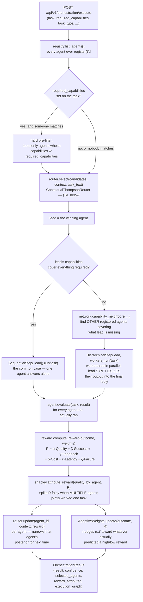

# ALGO AKANADE's agents — what each one is, and how a task actually flows through them

Nine agents ship registered by default (`app/framework/bootstrap.py`).
This is the catalog: what each one is, exactly what happens in each of
its six pipeline steps, and how a task moves through the shared
orchestration machinery around all of them. For how to build a *new*
one, see `README_NEW_AGENT_GUIDE.md` — this file is the "what already
exists" companion to that "how to add your own" one. For the routing
math itself, see `README_RL_ALGORITHMS.md`.

## The one interface every agent implements

`app/framework/agent_base.py`'s `Agent` is abstract over six steps.
`Agent.run(task)` always calls them in this fixed order — the
orchestrator never needs to know which steps a given agent actually
does interesting work in:

```
understand(task)        → parse/interpret the task into whatever this
                           agent needs internally
plan(task, understanding) → decide the concrete steps/tool calls
execute(task, plan)      → do the real work (call a model, call a tool,
                           scan a file) — almost always where the
                           interesting work actually happens
validate(task, result)   → check the raw result for correctness/safety
                           BEFORE it's phrased as a reply
respond(task, validated) → render the final AgentResult
evaluate(task, result)   → OPTIONAL — self-assessed quality in [0,1],
                           default = confidence if ok else 0.0
```

A simple agent can make `understand`/`plan`/`validate` near-identity
passthroughs (most of the catalog below does) and put all the real
logic in `execute()`. A few — `CodingAgent`, the three security agents —
do genuine work in `validate()`/`evaluate()` too; those are called out
below.

Every agent publishes an `AgentMetadata`: `agent_id`, `capabilities`
(a `frozenset[str]` the capability pre-filter matches against),
`supported_tasks`, `cost_per_call_usd`, a `LatencyProfile`, and a
`reliability_score` — the cold-start prior its bandit posterior is
seeded from before any real feedback exists (see below). None of this
metadata is enforced by a schema beyond the dataclass itself; it's what
the router reads to score an agent it otherwise knows nothing about.

## One task's actual journey (`app/framework/orchestrator.py`)



Three things worth being explicit about:

- **The capability pre-filter runs BEFORE the bandit ever scores
  anyone.** Without it, an agent with zero relevant capability could
  still win purely on reliability/cost/latency (those are only part of
  the utility sum) — which both wastes a hierarchical-delegation hop
  and teaches the bandit the wrong lesson about who's actually good at
  this task type.
- **Delegation is a property of the task, not hard-coded per domain.**
  If the winning agent's own `capabilities` already cover everything
  the task asked for, it just runs alone (`SequentialStep`, one agent,
  the common "simple question" case). Only when something's missing
  does `HierarchicalStep` kick in: workers matching the missing
  capability run in parallel (`ParallelStep`), and the lead's own
  `execute()`/`respond()` gets their output appended to the task text —
  a generic "Planner → Specialists → Synthesizer" shape, not a shape
  special-cased per agent.
- **Reward attribution is Shapley, not "give it all to the winner."**
  When a `HierarchicalStep` ran more than one agent, `shapley.py`
  splits the single computed reward `R` across every agent that
  contributed, using the same cooperative-game-theory value (Shapley,
  1953) that gets a shout-out in `README_RL_ALGORITHMS.md`. A lead that
  did nothing but paste a worker's answer verbatim gets less credit
  than one whose synthesis genuinely improved on the raw worker output.

`app/framework/workflow.py` also defines `ParallelStep`/`ConsensusStep`
(N independent takes, vote or pick highest-confidence) and
`FallbackStep`/`RetryStep` (priority order, first success wins) as
composable primitives — `orchestrator.execute()` only actually reaches
for `SequentialStep`/`HierarchicalStep` today; the others are available
to a caller building a custom `Workflow` by hand.

## The 9 agents shipped by default

| `agent_id` | Real capability | Cost/call | Reliability prior |
|---|---|---|---|
| `pm-agent` | Wraps the entire pre-existing PM chatbot verbatim | $0.002 | 0.85 |
| `pm-agent-adk` | Same PM chatbot, pinned to the Google ADK track specifically | $0.002 | 0.85 |
| `openclaw-agent` | Direct public Claude API, no tools | $0.003 | 0.75 |
| `coding-agent` | Code generation + real `ast.parse` validation | $0.004 | 0.70 |
| `mcp-utility-agent` | Tool set is ENTIRELY MCP-sourced | $0.001 | 0.70 |
| `langchain-research-agent` | Real `langchain_core` Runnable + real `BaseRetriever` RAG | $0.002 | 0.70 |
| `code-security-agent` | Deterministic Python vulnerability pattern scan | $0.003 | 0.75 |
| `supply-chain-agent` | Real OSV.dev dependency vulnerability lookups | $0.003 | 0.70 |
| `cloud-config-agent` | Deterministic Dockerfile/K8s/Terraform misconfig scan | $0.003 | 0.70 |

### `pm-agent` — the pre-existing PM chatbot, wrapped

`app/framework/agents/pm_agent.py`. Proves ALGO AKANADE is *additive*, not a
rewrite: every prompt in `CHAT_PROMPTS.md`, every test in
`tests/test_agent_flows.py`, still goes through the exact same
`get_agent(framework).handle_message(...)` call this wrapper delegates
to — nothing about the PM domain's own 17-step
`native_agent.handle_message` pipeline (perceive → resolve → confirm →
execute → format) is touched or reimplemented.

- `understand`/`plan` — near-identity; the PM chatbot's own internal
  pipeline already does perceive/resolve in one call.
- `execute` — calls `get_agent(self.framework).handle_message(user,
  session_id, task.text, preferred_provider=...)`. `self.framework` is
  `None` here (this deployment's configured default track).
- `validate` — a passthrough; `native_agent`'s own input/output guards
  already ran inside `execute()`.
- `respond` — confidence is `0.4` if the reply is a pending
  confirmation (a yes/no still outstanding), `0.85` otherwise.

### `pm-agent-adk` — the same chatbot, pinned to one framework track

Same `PMAgent` class, constructed with `framework="adk"` — Google ADK's
`Runner`/`LlmAgent` machinery exposed as its OWN independently-routable,
independently-scored ALGO AKANADE agent, rather than a query-param buried
inside `pm-agent`. This is what lets the bandit directly compare ADK's
real-world latency/reliability against native/langgraph's, agent vs.
agent, instead of only ever seeing "pm-agent" as one blended number.

### `openclaw-agent` — general-purpose, no tools

`agents/openclaw_agent.py`. "Open" because it talks to Claude's genuinely
public API (`llm/providers.py`'s `AnthropicNative`, registered as the
`"claude"` provider) — proof the model-abstraction layer is reusable by
a plain, tool-free agent as easily as by the PM domain's tool-calling
one, and it degrades through the normal provider chain if
`CLAUDE_API_KEY` is unset, same as every other rung.

- `plan` — one system prompt ("you have no tools, never claim to have
  taken an action") + the user's text.
- `execute` — `get_llm_client("realtime", preferred="claude").chat(...)`.
  One model call, nothing else.
- `respond` — confidence `0.8` on success, `0.0` and an honest "every
  model rung failed" message on total failure.

### `coding-agent` — the framework's own worked "new domain" example

`agents/coding_agent.py` is literally what `README_NEW_AGENT_GUIDE.md`
walks through building — the entire integration surface for a
brand-new domain is one file, registered the same way `pm-agent` is.

- `execute` — one call to `get_llm_client("delay_ok", ...)` with a
  system prompt asking for a fenced ` ```python ` block.
- `validate` — **real work, not a stub**: extracts every fenced Python
  block from the reply and runs it through `ast.parse` — a genuine
  syntax check. On a syntax error, it retries the model ONCE with the
  parse error appended (the same "retry once on a validation failure"
  shape `native_agent.py`'s own `output_guard` uses for tool-call
  validation, reapplied here for code validity).
- `respond` — confidence `0.85` if the retried-or-original code parses
  clean, `0.4` if it still doesn't, `0.0` on a hard model failure.
- `evaluate` — **overridden**, not the base-class default: a
  syntactically valid block is a stronger self-assessed quality signal
  than confidence alone, so this halves confidence when `syntax_ok` is
  false rather than trusting the raw number.

### `mcp-utility-agent` — proving MCP is a first-class capability source

`agents/mcp_utility_agent.py`. Its entire tool set comes from
`agent/mcp_client.py`'s `MCP_SERVERS` config — nothing PM-specific.
Bundled default is the offline `utility_server.py` example
(`get_current_datetime`, `days_between`); point `MCP_SERVERS` at any
real external MCP server and this agent gains its tools with **zero
code changes here** — `tools = tuple(mcp_client.mcp_tool_names())` in
`__init__` picks them up automatically. This exists specifically so MCP
tools aren't only ever seen merged into `pm-agent`'s much larger tool
list, where it'd be easy to miss that MCP is a real, general capability
source and not a PM-only add-on.

- `execute` — `client.chat(..., mcp_client.mcp_tool_specs())` — ONLY
  the MCP tool specs, deliberately never `tools.openai_tool_specs()`'s
  full PM set.
- `validate` — if the model called a tool, actually calls
  `mcp_client.call_mcp_tool(...)` and catches a failure into a "Sorry —
  that failed" string rather than raising.

### `langchain-research-agent` — a real LangChain `Runnable` + real RAG

`agents/langchain_research_agent.py`, wrapped via
`langchain_adapter.LangChainRunnableAgent`. Not an adapter module sitting
unused — an actual `RunnableLambda | ChatPromptTemplate | RunnableLambda`
pipeline, built with real `langchain_core` imports and a real `|` pipe.
It also builds a genuine `langchain_core.retrievers.BaseRetriever` over
ALGO AKANADE's own in-memory RAG store (`vector_store_to_retriever`), seeded
from a tiny 3-fact knowledge base about ALGO AKANADE's own routing math — so
retrieval demonstrably changes the answer, not just a decorative
`BaseRetriever` nobody calls.

- The `RunnableLambda` in the middle bridges to `llm/router.py`'s own
  provider chain rather than a LangChain chat-model integration
  (`ChatOpenAI`/`ChatAnthropic`) — keeps the example dependency-light
  while still being swappable for a real LangChain model wrapper
  without touching how this agent is registered or routed.
- Uses `Agent`'s six-step interface only indirectly; `LangChainRunnableAgent`
  (`agent/langchain_adapter.py`) is the thin bridge that makes a
  `Runnable.invoke()` satisfy ALGO AKANADE's `execute()` contract.

### `code-security-agent`, `supply-chain-agent`, `cloud-config-agent` — deterministic first, LLM second

All three share one rule, documented once in
`agents/security_findings.py`: **real detection happens first**
(regex pattern matching over real source text, or a real query against
a real vulnerability database), and the LLM is only ever handed the
resulting fixed `Finding` list to *summarize* — it can never invent,
add, or omit a finding. `format_findings_for_prompt()` is the ONLY
thing the LLM ever sees about what was found, so the summary can't
drift from what was actually detected. See `README_CYBERSECURITY.md`
for the full threat model this backs.

- **`code-security-agent`** — six line-based regex rules (`eval`/`exec`,
  `shell=True`, `os.system`, unsafe `pickle`/`yaml.load`, weak
  `md5`/`sha1` hashing) plus a hardcoded-secret pattern, scanned against
  either a real file/directory under `RAG_INGEST_DIR` (path-traversal
  guarded via `document_pipeline.resolve_within()`, shared with RAG
  ingestion) or pasted code in `task.text`. Known, stated limitation:
  line-based regex over raw text, not a real AST analysis — a rule's
  own docstring mentioning `eval()` in prose can false-positive the
  same way a real usage would.
- **`supply-chain-agent`** — parses a `requirements.txt`-shaped manifest,
  and for every EXACTLY pinned dependency (`name==1.2.3`), calls
  `query_osv()` — a real HTTP POST to `api.osv.dev`, the same public
  vulnerability database `pip-audit`/`osv-scanner` use. An unpinned
  dependency is reported as skipped with a reason, never silently
  ignored or guessed at (OSV.dev needs an exact version to check).
- **`cloud-config-agent`** — seven format-agnostic regex rules across
  Dockerfile/compose/Kubernetes/Terraform (privileged containers,
  `0.0.0.0/0`, `hostNetwork:true`, root user, public-access flags,
  disabled encryption, `:latest` tags) plus a missing-`USER`-directive
  check specific to Dockerfiles. No live cloud-provider API calls —
  scans the config FILES that define your infrastructure, the same
  static-analysis approach `checkov`/`tfsec` use. Validated for real
  against this repo's own `deploy/Dockerfile.*`.

All three additionally override `evaluate()`: a scan that actually
checked something (`scan.scanned` non-empty) keeps full confidence; one
that skipped everything gets it halved — "found nothing" and "checked
nothing" are different outcomes, and the reward signal should say so.

## Registering an agent beyond these 9

Two paths, both landing in the same registry/router/feedback machinery
above — see `README_NEW_AGENT_GUIDE.md` for the full walkthrough:

1. **In-process** — `registry.register(MyAgent())` +
   `network.add_agent(MyAgent().metadata)`, the exact pattern
   `bootstrap.py` uses for all 9 above. One new line, nothing existing
   touched.
2. **Runtime, no code deploy** — `POST /api/v1/agents/register` with a
   `webhook_url`. ALGO AKANADE builds a `RemoteHttpAgent`
   (`agents/remote_agent.py`) proxy: `execute()` POSTs
   `{task_id, text, session_id, metadata}` to your endpoint and expects
   `{text, ok, confidence}` back. Your agent can be written in any
   language, hosted anywhere — ALGO AKANADE never needs your source, and it
   still gets scored by the identical Thompson Sampling bandit and
   Shapley-attributed reward every in-process agent does.
