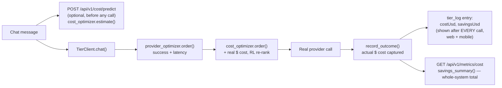
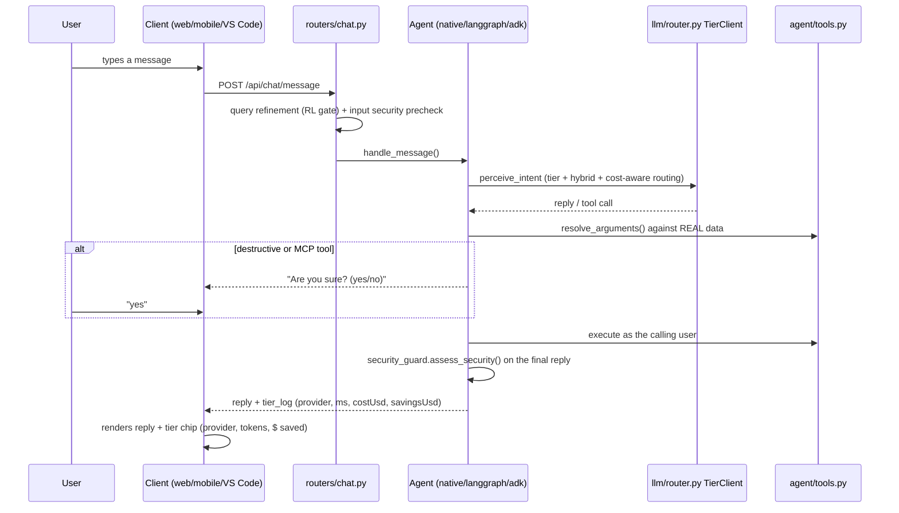
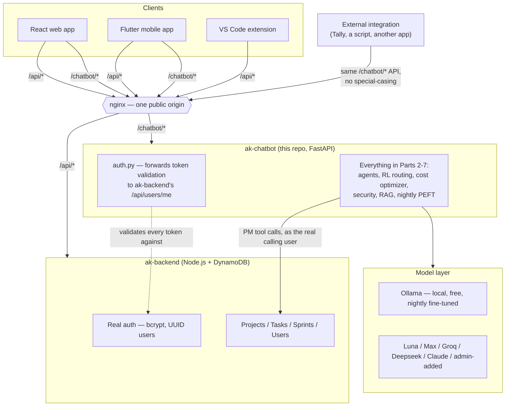

# ALGO AKANADE — Complete System Guide

One orientation document for the whole system — what it is, every
layer, the RL that makes it self-improving, the cost layer that keeps
it affordable, the security model, the APIs, and how the web app,
mobile app, backend, local models, and external integrations all fit
together. Each Part below is short enough to read start to finish and
links to the existing deep-dive doc for the full detail (math, test
tables, line-by-line prose) — this file's job is to be the map, not to
duplicate any of those.

**Who this is for**: a new engineer joining the project, or an external
developer integrating with ALGO AKANADE's REST API, who wants the whole
picture before diving into any one file.

---

## Table of contents

- [Part 1 — What ALGO AKANADE is](#part-1--what-akanade-is)
- [Part 2 — Architecture layers](#part-2--architecture-layers)
- [Part 3 — RL components, and how they actually work](#part-3--rl-components-and-how-they-actually-work)
- [Part 4 — Token optimization and cost prediction](#part-4--token-optimization-and-cost-prediction)
- [Part 5 — Security architecture](#part-5--security-architecture)
- [Part 6 — APIs and integrations](#part-6--apis-and-integrations)
- [Part 7 — End-to-end workflows](#part-7--end-to-end-workflows)
- [Part 8 — File and responsibility map](#part-8--file-and-responsibility-map)
- [Part 9 — How mobile, web, APIs, models, and integrations work together](#part-9--how-mobile-web-apis-models-and-integrations-work-together)
- [Part 10 — Build, deployment, and Docker](#part-10--build-deployment-and-docker)

---

## Part 1 — What ALGO AKANADE is

**ALGO AKANADE** (Multi-Agent GenAI Network with Evolving Training and
Orchestration) is a domain-agnostic multi-agent orchestration framework
with a real production tenant (Aksha PM, a project-management app)
running on top of it. Three things make it different from "just call an
LLM":

1. **It routes, and learns from routing.** Every non-trivial decision —
   which agent handles a task, which model tier answers it, whether to
   run retrieval first, how big a tool schema to send a local model,
   which provider is currently the cheapest reliable choice — is made
   by a small reinforcement-learning bandit that updates from real
   outcomes, not a fixed if/else chain. See [Part 3](#part-3--rl-components-and-how-they-actually-work).
2. **It runs a real local model, not just a wrapper around paid APIs.**
   A quantized SLM (Qwen2.5, served by Ollama) answers a real share of
   traffic for free, gets nightly fine-tuned (LoRA/QLoRA) on the
   organization's own real usage, and is regression-gated before ever
   replacing the model currently live. See `README_SLM_ALL.md`.
3. **It has a real cost and security posture, not an afterthought.**
   The Token & Cost Optimizer ([Part 4](#part-4--token-optimization-and-cost-prediction))
   predicts spend before a call happens and tracks real savings after
   it. The security layer ([Part 5](#part-5--security-architecture))
   deterministically flags every turn and hard-blocks real attack
   classes (credential exfiltration, prompt injection embedded in
   fetched content) before any tool runs.

ALGO AKANADE ships as one FastAPI backend (`orchestrator_framework_layer/akanade/backend`)
with three real clients: a React web app, a Flutter mobile app (both in
`tool_layer_akanade/`), and a VS Code extension (`tool_layer_coding/`).
A generic external integration surface (`README_EXTERNAL_API.md`) lets
any other application — a Tally ERP plugin, a React Native app, a
plain script — talk to the exact same backend the official clients use.

**Full architecture deep-dive**: `ARCHITECTURE.md`. **Fast one-line
index of every subsystem + glossary**: `README_TECH_DOC.md`. **Plain-
language explanations**: `README_EXPLAINED.md`.

---

## Part 2 — Architecture layers

### The whole system, top to bottom

```mermaid
flowchart TB
    subgraph CLIENTS["Clients — three real front doors, one shared backend"]
        WEB["Web app\ntool_layer_akanade/frontend (React)"]
        MOB["Mobile app\ntool_layer_akanade/mobile (Flutter)"]
        VSC["VS Code extension\ntool_layer_coding/vscode-extension"]
        EXT["Any external app\nintegrations/ (Tally, React, React Native, Dart)"]
    end

    subgraph GATEWAY["nginx — one origin, two backends behind it"]
        NGX["/api/*  → ak-backend  (real PM app, Node + DynamoDB)\n/chatbot/* → ak-chatbot (this repo's FastAPI app)"]
    end

    subgraph ALGO AKANADE["ak-chatbot — the ALGO AKANADE backend (FastAPI)"]
        direction TB
        GUARD["Query refinement + input security precheck\ngmaofn/query_refinement.py, security_guard.py"]
        AGENTFW["Agent framework (app/framework/)\nregistry → Thompson-Sampling router →\nworkflow engine → Shapley credit → reward"]
        PM["pm-agent / pm-agent-adk\nwraps native/langgraph/adk/claude tracks"]
        LLML["Model routing layer (app/llm/)\nprovider_optimizer → cost_optimizer →\ntoken_optimizer → hybrid_router → providers"]
        RAG["Retrieval (app/retrieval/, framework/rag*.py)\nRL-picked store × algorithm"]
        SEC["Security (security_guard.py, security_optimizer.py)\ndeterministic flag + RL confidence note"]
        FT["Nightly PEFT pipeline (deploy/, scripts/)\nreward-weighted LoRA → GGUF → regression gate"]
        DB[("db.py — LocalStore ⇄ DynamoStore")]
    end

    subgraph MODELS["Model layer"]
        OLLAMA["Ollama (local, free)\nbase SLM + nightly fine-tuned domain tags"]
        HOSTED["Hosted providers\nLuna / Max / Groq / Deepseek / Claude / admin-added"]
    end

    subgraph EXTSVC["External services"]
        GOOGLE["Gmail / Calendar / Chat (OAuth)"]
        MCP["MCP tool servers"]
        OSV["OSV.dev (vulnerability DB)"]
        STOOQ["Stooq (free market data, Trading Agent)"]
    end

    CLIENTS --> NGX --> ALGO AKANADE
    GUARD --> AGENTFW --> PM
    PM --> LLML
    LLML --> MODELS
    PM --> RAG --> DB
    PM --> SEC
    LLML -. real usage .-> FT
    FT -. promotes .-> OLLAMA
    PM --> EXTSVC
```

### Layer by layer — what each one does

| Layer | Where it lives | What it does |
|---|---|---|
| **Query refinement** | `app/framework/query_refinement.py` | RL-gated rewrite-for-clarity, with an embedding-memory cache so a repeat/near-duplicate query costs nothing extra. |
| **Input security precheck** | `security_guard.py`, `native_agent.security_precheck()` | Hard-blocks credential exfiltration, bulk data-exfil asks, and "skip confirmation" instructions before any tool ever runs. |
| **Agent framework** | `app/framework/` (`registry.py`, `router.py`, `network.py`, `workflow.py`, `shapley.py`, `reward.py`) | Generic multi-agent orchestration: capability filter → Thompson-Sampling agent pick → workflow shape (sequential/parallel/consensus/fallback/retry/hierarchical) → Shapley credit split → reward → policy update. Reached via `POST /api/v1/orchestration/execute`. |
| **pm-agent / domain agents** | `app/framework/agents/*.py` | 9 agents registered by default: `pm-agent`, `pm-agent-adk`, `openclaw-agent`, `coding-agent`, `mcp-utility-agent`, `langchain-research-agent`, and three security agents. See `README_AGENTS.md`. |
| **PM chatbot pipeline** | `app/agent/` (`native_agent.py`, `langgraph_agent.py`, `adk_agent.py`, `claude_agent.py`, `tools.py`) | The 17-step turn: guards → tier/hybrid routing → intent classification → optional RAG → entity resolution → confirmation gate → tool execution → templated reply → persistence. Reached via `POST /api/chat/message`, the endpoint every real client actually calls for chat. |
| **Model routing** | `app/llm/router.py`, `providers.py` | `TierClient.chat()` — the single choke point every LLM call passes through: policy gate → availability/budget filter → `provider_optimizer.order()` → **`cost_optimizer.order()`** → policy resort → preferred override → per-provider fallback chain ending in a deterministic rule-based floor that never errors. |
| **Token optimizer** | `app/llm/token_optimizer.py` | For local (Ollama) providers only: trims the tool-schema JSON sent with each call, RL-picked reduction level. |
| **Cost optimizer** | `app/llm/cost_optimizer.py`, `pricing_table.py` | Predicts $ cost before a call, re-ranks providers toward cheaper reliable ones, tracks real spend/savings. Full writeup: [Part 4](#part-4--token-optimization-and-cost-prediction). |
| **Retrieval (RAG)** | `app/framework/rag.py`, `rag_optimizer.py`, `app/retrieval/` | RL-picked `{store}::{algorithm}` (vector / lexical_rerank / hybrid), IVF-clustered and quantized once a store passes a size threshold. |
| **Security** | `security_guard.py`, `security_optimizer.py`, `security_events.py`, `security_report.py` | Deterministic 🟢/🟡/🔴 flag on every turn, an RL confidence layer on top (never authoritative), and an Admin dashboard with a real daily LLM-summarized report. Full writeup: [Part 5](#part-5--security-architecture). |
| **Security scan agents** | `app/framework/agents/{code_security,supply_chain,cloud_config}_agent.py` | On-demand, not per-turn: deterministic regex scans + a real OSV.dev dependency lookup. An LLM only summarizes findings, never invents them. |
| **Nightly PEFT fine-tune** | `deploy/nightly_finetune.sh`, `scripts/finetune_local_slm.py`, `scripts/convert_and_register_ollama_model.sh` | Batch, cron, entirely outside the request path: collect reward-tagged Ollama turns → reward-weighted LoRA → GGUF-quantize → regression-gate against the currently-served tag → promote or discard. See `README_SLM_ALL.md`, `README_SLM_PIPELINE.md`. |
| **PEFT Analyzer** | `scripts/peft_analyzer_scrape.py`, `app/agent/peft_analyzer.py` | Scrapes real reference content (capped, deduped) into the same ground-truth JSONL the nightly trainer reads, so a domain with little organic chat traffic still has real data to train on. See `README_PEFT_ANALYZER.md`. |
| **Trading Agent** | `app/framework/agents/trading_agent.py` (via `app/agent/trading_tools.py`) | Backtesting + strategy analysis against free Stooq price data, combinable with `coding-agent` via an explicit two-agent `SequentialStep`. See `README_TRADING_AGENT.md`. |
| **Data model** | `app/db.py`, DynamoDB-shaped tables | `LocalStore` (dev, JSON files) or `DynamoStore` (prod) behind one interface — see `README_DATA_MODEL.md` for every table. |
| **Deployment** | `deploy/` | Docker Compose services (`ak-backend`, `ak-chatbot`, `ak-frontend`, `ak-dynamo`, `ak-finetune-cron`), nginx routing, `update_containers.sh`. See [Part 10](#part-10--build-deployment-and-docker). |

---

## Part 3 — RL components, and how they actually work

**Everything in this section is a bandit** — a reinforcement-learning
setting where a fixed set of "arms" (options) is repeatedly chosen
between, learning purely from each choice's own observed reward, no
state carried between choices. The one exception is the nightly PEFT
loop, which is real weight-space learning (a reward-weighted loss), not
a bandit.

### The shared primitive

Every bandit in this codebase is the **same ~60-line class**,
`LinearBanditCore` (`app/framework/bandit.py`) — Bayesian linear
regression with Thompson Sampling:

- `ensure(arm_id, seed_utility)` — registers an arm, seeded with a
  hand-designed prior so routing isn't arbitrary on day one (cold
  start).
- `score(arm_id, context_vector, seed_utility)` — samples a random
  guess from that arm's current belief distribution (Thompson
  Sampling), returning both the sample and the posterior mean.
- `select(arm_ids, context_vector, seed_utilities)` — scores every arm
  and returns whichever sampled highest (`argmax`).
- `update(arm_id, context_vector, reward)` — folds one real observed
  outcome into that arm's posterior.
- `to_state()` / `load_state()` — plain-dict serialization, used by
  `app/framework/bandit_persistence.py`'s `save(name, core)` /
  `load(name, core)` for the two bandits durable across restarts
  (`security_optimizer`, `provider_optimizer`) — see the table below.

No optimizer in this repo reimplements bandit math; each one just
picks its own arm set, context features, and reward formula on top of
this one class. Full derivations: `README_RL_ALGORITHMS.md`.

### Every RL layer in the system

| Layer | File | Arms | Reward signal | Persisted? |
|---|---|---|---|---|
| Agent routing | `app/framework/router.py` | Any registered agent | Shapley-attributed multi-factor reward (below) | No |
| Framework picker | `app/agent/framework_stats.py` | native / langgraph / adk | Latency + error history | No |
| Generation params | `app/llm/optimization_router.py` | balanced / low_latency / high_quality | Success − latency penalty | No |
| Tool-schema size | `app/llm/token_optimizer.py` | full / top12 / top6 / top3 | Success + tokens-saved bonus | No |
| RAG source + algorithm | `app/framework/rag_optimizer.py` | every `{store}::{algorithm}` pair | Success/empty-result penalty | No |
| Local vs hosted | `app/llm/hybrid_router.py` | local / hosted | Success, latency, escalation penalty | No |
| Provider ordering | `app/llm/provider_optimizer.py` | `{tier}::{provider}` | Success/failure ± latency penalty | **Yes** |
| **Cost-aware ordering** | `app/llm/cost_optimizer.py` | `{tier}::{provider}` | Success/failure ± latency ± truncation ± **real $ cost** | **Yes** |
| Domain SLM routing | `app/llm/domain_router.py` | registered fine-tuned domain variants | Success on that domain's real turns | Yes |
| Security findings | `app/security_optimizer.py` | `{rule_id}::{source}` | +1 declined / −1 approved by a real human | **Yes** |
| Model weights (PEFT) | `scripts/finetune_local_slm.py` | *(not a bandit)* | Reward-weighted cross-entropy loss | Yes (checkpoint on disk) |

**Shapley-value credit** (`app/framework/shapley.py`): when a workflow
runs more than one agent for a task, one observed reward has to be
split fairly across every participant. This uses the classic
cooperative-game-theory solution — each agent's average marginal
contribution across every possible arrival order, with a noisy-OR
characteristic function (probability at least one member produced a
good result). Each agent's own bandit then updates with **its** share,
not the raw total.

**Adaptive reward weights** (`app/framework/reward.py`):
`R = α·Quality + β·Success + γ·Feedback − δ·Cost − ε·Latency − ζ·Failure`,
and the weights `α..ζ` themselves drift toward whatever has actually
correlated with a high `R`, renormalized to sum to 1 — the reward
function is learned too, not just the routing on top of it.

---

## Part 4 — Token optimization and cost prediction

The **Token & Cost Optimizer** is the newest layer, added specifically
because paid hosted models (Claude/GPT-class tiers, Groq, DeepSeek) sit
alongside free local SLMs in the same routing chain, and nobody had a
real answer to "what is this actually costing us, and is it going
down." Full doc: `README_TOKEN_COST_OPTIMIZER.md`.



**What it does**:
1. **Predicts cost before execution** — `POST /api/v1/cost/predict`
   estimates token count (chars/4 heuristic) and $ cost across every
   model available for a tier, before any of them is called.
2. **Selects the most cost-effective model while maintaining quality**
   — a Thompson Sampling bandit re-ranks the chain `provider_optimizer`
   already ordered, seeded toward cheaper candidates but learning from
   real outcomes: success dominates, then latency, then whether the
   reply was truncated (a real quality signal), then real dollar cost.
3. **Uses RL feedback to continuously improve** — every real call
   updates the bandit's posterior for that `(tier, provider)` pair,
   same persisted `LinearBanditCore` mechanism as `provider_optimizer`.
4. **Tracks token usage, latency, quality, and cost savings** — both in
   aggregate (`GET /api/v1/metrics/cost`, Admin dashboard) and now
   **per call**: `router.py`'s `TierClient.chat()` computes each
   answering call's real `costUsd` and `savingsUsd` (vs. this system's
   priciest known provider rate for the same tokens) and adds both to
   that turn's `tier_log` entry — the exact structure the web app's
   `ChatAssistant.tsx` and the mobile app's `ai_chat_screen.dart` both
   already read per turn, so the savings badge shows up after **every**
   real API/model call on both platforms with no new endpoint.

**Pricing** (`app/llm/pricing_table.py`): best-effort public list
prices per provider, checked only after an admin-configured
`provider_budget.py` rate (which always wins when set). Ollama and the
deterministic `rule` floor are always exactly $0.00. `max_known_rates()`
/ `counterfactual_cost_usd()` compute the "what would this have cost on
the priciest known alternative" baseline shared by both the whole-
system `savings_summary()` and the new per-call
`cost_and_savings_for_call()` — same basis, so a single call's badge
and the dashboard's total are always mutually consistent.

**Composition with the rest of routing** — this never replaces the
existing safety net, only adds a re-rank step:

```
policy gate (safety) → availability/budget filter
  → provider_optimizer.order()   (success + latency, pre-existing)
  → cost_optimizer.order()       (+ real $ cost, this layer)
  → force_local/force_hosted policy resort (safety, still wins outright)
  → preferred override (a user's own model pick, still wins outright)
```

---

## Part 5 — Security architecture

Full doc with the complete test-results table: `README_CYBERSECURITY.md`.

### Two layers, two different jobs

1. **`security_guard.py` — deterministic, the sole authority.** Regex
   rules (each with a stable `SEC-*` id) over every real text surface a
   turn touches — the user's own prompt, and content read FROM
   Gmail/Calendar/Chat/MCP tools once rendered into the reply. Produces
   one of `🟢 Safe` / `🟡 Needs Review` / `🔴 Security Risk` —
   reproducible, never an LLM guessing at its own safety.
2. **`security_optimizer.py` — RL, additive only, never authoritative.**
   A persisted bandit that learns, per `(rule_id, source)` pair,
   whether that specific pattern on that specific surface has tended to
   be a real concern or a nuisance — from real human yes/no answers on
   flagged confirmations. Surfaces an optional note; never changes
   whether a rule fires, and is never consulted for `🔴 RISK` at all
   (RISK always blocks unconditionally, before this layer is reached).

### Two gates

- **Input precheck** (`native_agent.security_precheck()`) — hard-blocks
  credential/token exfiltration, bulk data-exfil requests, and explicit
  "skip confirmation" instructions, before any tool runs. Same shape as
  `llm/guardrails.py`'s `input_guard()`, identical across all four
  framework tracks.
- **Confirmation gate** (`requires_confirmation()` / `confirm_prompt_for()`)
  — every destructive PM action, every MCP tool call, and every Google
  write tool (`send_email`, `create_calendar_event`, ...) requires an
  explicit yes/no showing the exact arguments before it runs. A
  🟡-flagged action also shows the RL layer's learned note, if any.

### The specific threat this closes: indirect prompt injection

An instruction found **inside** fetched content (an email body, a
calendar invite, a tool's own response) — not typed by the user — is
automatically `🔴 RISK`, strictly more severe than the identical phrase
typed by the user directly (`🟡`). The assistant never treats "content
it read" as "an instruction it should obey."

### Admin visibility

Every 🟡/🔴 flag is durably logged (`security_events.py`) and visible at
`/admin/security` (Admin role or above) — recent events across the
whole org, plus a daily LLM-written report (`security_report.py`) that
is explicitly forbidden from inventing, adding, or omitting an event,
with a real non-LLM fallback summary if every provider is unreachable.
Read-only: nothing here lets an Admin suppress or act on a flagged
conversation remotely — that decision stays with the person the
conversation belongs to.

### Security scan agents (on demand, not per chat turn)

`code-security-agent` (regex over Python source for secrets,
`eval`/`exec`, `shell=True`, unsafe deserialization), `supply-chain-agent`
(exactly-pinned deps checked against the real OSV.dev vulnerability
database), `cloud-config-agent` (regex over Dockerfile/compose/K8s/
Terraform for privileged containers, `0.0.0.0/0`, disabled encryption).
All three: deterministic detection first, an LLM only summarizes the
real findings list that already exists.

---

## Part 6 — APIs and integrations

Full REST reference with request/response shapes: `README_EXTERNAL_API.md`.

### The one endpoint every platform actually uses

```
POST /api/chat/message
{ "message": "...", "session_id": "...", "provider": null }
```

The web app, the mobile app, and (via its own tools) VS Code all call
this **same** endpoint. It reaches PM Tool, Trading Agent, and Train
Algo AI — implemented exactly once in the shared pipeline, never
reimplemented per platform. See `README_UNIFIED_AGENT_TESTING.md` for
the proof-by-testing of this claim.

### Other real surfaces

| Purpose | Endpoint(s) | Notes |
|---|---|---|
| Auth | `POST /api/auth/login` | JWT, no refresh flow — catch `401` and re-login. |
| Sandboxed coding | `POST /api/v1/orchestration/execute` | The generic agent-framework entry point; `agents: [...]` can force an explicit multi-agent `SequentialStep`. |
| Train a domain model | `POST /api/peft-training/{link,upload}` | Indexed into RAG immediately, logged as ground truth for the next nightly fine-tune. |
| Predict cost | `POST /api/v1/cost/predict` | See [Part 4](#part-4--token-optimization-and-cost-prediction). |
| Cost/routing/RAG metrics | `GET /api/v1/metrics/*` | Admin-only, bandit weights and per-provider stats. |
| Security dashboard | `GET /api/admin/security/*` | Admin-only. |
| Agent registry | `GET /api/v1/agents` | Every registered agent + declared capabilities. |

### Integrations (`integrations/`)

- **`algo-akanade-connector`** — the plain HTTP client module (login,
  `sendMessage`, RAG ingest/summarize) any JS/TS app imports directly.
- **`algo-akanade-react`** / **`algo-akanade-react-native`** /
  **`algo_akanade_connector_dart`** — thin wrappers of the above for
  each client framework.
- **`algo-akanade-voice`** / **`algo_akanade_voice_dart`** — voice
  input/output helpers, framework-specific.
- **`tally-connector`** — a real, downloadable, double-click packaged
  program (Windows `.exe` / Linux binary) that gives Tally ERP a popup
  chat backed by this exact API surface, aimed at non-technical users.
  XML parsing tested against realistic sample data; see that package's
  own README for exactly what is and isn't verified against a live
  Tally instance.

### External services this backend actually calls

Gmail / Calendar / Chat (OAuth, per user), MCP tool servers (stdio/SSE,
confirmation-gated), OSV.dev (free, no-auth vulnerability database),
Stooq (free, keyless daily price data for the Trading Agent).

---

## Part 7 — End-to-end workflows

### 1. A normal chat turn (web, mobile, or VS Code — identical pipeline)



### 2. Multi-agent orchestration (explicit combination)

```
POST /api/v1/orchestration/execute {"task": "...", "agents": ["trading-agent", "coding-agent"]}
  → Workflow([SequentialStep([TradingAgent(), CodingAgent()])])
  → Trading Agent's strategy output is prepended to Coding Agent's task
  → Shapley-splits the one observed reward across both agents
  → each agent's own bandit posterior updates with its share
```

### 3. Nightly PEFT fine-tune (fully automated, outside any request path)

```
02:00  DB dump
03:30  nightly_finetune.sh runs inside ak-finetune-cron:
       → peft_analyzer_scrape.py tops up any config'd domain with fresh scraped ground truth
       → per enabled domain: filter reward ≥ 0.7, most recent 500 turns
       → render through the model's own chat template, mask loss to the assistant's turn
       → LoRA (r=8, α=16), reward-weighted loss → merge
       → convert_and_register_ollama_model.sh: GGUF-quantize (Q4_K_M) → new Ollama tag
       → regression gate vs. the currently-served tag (same eval harness, zero cost, local-only)
       → pass → register with the live chatbot, no restart · fail → discard, old tag stays live
```

### 4. External integration (e.g. the Tally connector)

```
Tally add-on → algo-akanade-connector (login + sendMessage)
  → POST /api/auth/login → POST /api/chat/message
  → same pipeline as workflow #1 above, same security/cost/RL layers,
    zero special-casing for "this caller isn't the official web/mobile app"
```

---

## Part 8 — File and responsibility map

### Backend (`orchestrator_framework_layer/akanade/backend/app/`)

| Path | Responsibility |
|---|---|
| `main.py` | FastAPI app assembly, router mounting, startup. |
| `auth.py` | JWT issuance/validation; forwards to the real Aksha PM backend's own `/api/users/me` when `REAL_APP_API_BASE_URL` is set (real-app deployments), else decodes locally. |
| `db.py` | `LocalStore` (JSON files, dev) / `DynamoStore` (prod) behind one interface. |
| `security_guard.py`, `security_optimizer.py`, `security_events.py`, `security_report.py` | The security layer — see [Part 5](#part-5--security-architecture). |
| `agent/` | The pre-existing PM chatbot: `native_agent.py` / `langgraph_agent.py` / `adk_agent.py` / `claude_agent.py` (the four framework tracks), `tools.py` (resolve + execute), `mcp_client.py`, `google_tools.py`, `finetune_log.py` (ground-truth logging), `peft_analyzer.py`, `trading_tools.py`. |
| `llm/` | Model abstraction + all routing optimizers: `router.py` (the choke point), `providers.py`, `provider_optimizer.py`, `cost_optimizer.py`, `pricing_table.py`, `token_optimizer.py`, `hybrid_router.py`, `domain_router.py`, `provider_budget.py`, `policy_gate.py`, `guardrails.py`. |
| `framework/` | The generic multi-agent framework (the "gmaofn" package, referenced by that name in prose/docstrings): `registry.py`, `router.py`, `network.py`, `workflow.py`, `shapley.py`, `reward.py`, `rag.py`/`rag_optimizer.py`, `query_refinement.py`, `task_memory.py`, `bandit.py`/`bandit_persistence.py`, `bootstrap.py` (registers all default agents), `agents/*.py`. |
| `retrieval/` | `graph.py` (NetworkX PM-data graph queries) + `vectorstore.py` (Chroma-backed semantic search). |
| `routers/` | REST endpoints: `chat.py`, `pm.py`, `acp.py`, `oauth.py`, `peft_jobs.py`, `peft_training.py`, `admin_*.py` (finetune-config, providers, provider-budgets, security, slm, eval-reports), `v1/` (`orchestration.py`, `agents.py`, `cost.py`, `metrics.py`, `rag.py`, `tasks.py`, `tools.py`, `workflows.py`, `feedback.py`). |
| `services/` | `pm_service.py` (the mini PM domain logic), `google_api.py` (Gmail/Calendar/Chat). |
| `oauth/`, `oauth_store.py` | Per-user OAuth token storage for Google + MCP servers. |
| `mcp_servers/` | The bundled reference MCP server (`utility_server.py`). |

### Web frontend (`tool_layer_akanade/frontend/src/`)

| Path | Responsibility |
|---|---|
| `pages/ChatAssistant.tsx` | The chat UI — talks to `ak-chatbot` directly (`api/chatbot.ts`, `VITE_CHATBOT_BASE_URL`), not the main PM backend; renders the tier chip (provider, tokens, security flag, **cost/savings**) after every reply. |
| `pages/{Peft,Rl,CostOptimizer}MetricsDashboard.tsx` | Admin dashboards over `GET /api/v1/metrics/*` and `GET /api/v1/metrics/cost`. |
| `pages/AdminSecurity.tsx` | The security events + daily-report dashboard. |
| `api/chatbot.ts` | The `ak-chatbot` client — `sendChatMessage()`, `ChatReply`/`ChatTierLogEntry` types (now including `costUsd`/`savingsUsd`). |
| `api/costOptimizer.ts` | `predictCost()`, `getCostMetrics()` against the main PM backend's admin routes. |
| `components/`, `hooks/`, `store/` | Shared UI, `useAuth`, `useChatBot`, `useVoice`, app-wide state. |

### Mobile app (`tool_layer_akanade/mobile/lib/`)

| Path | Responsibility |
|---|---|
| `core/config/app_config.dart` | `apiBaseUrl` (main PM backend) and derived `chatbotBaseUrl` (`ak-chatbot`, same nginx origin, `/chatbot` prefix) — every network call goes through these two, never a hardcoded host. |
| `models/chat_models.dart` | Wire shapes mirroring `frontend/src/api/chatbot.ts` — `ChatReply`, `ChatTierLogEntry` (now with `costUsd`/`savingsUsd`), `ChatBubbleData`. |
| `repositories/chat_repository.dart` | `sendMessage()` → `POST /api/chat/message` on `chatbotBaseUrl`. |
| `providers/chat_provider.dart` | Riverpod state — turns a `ChatReply` into a `ChatBubbleData`, now including `costUsd`/`savingsUsd` from the reply's last `tier_log` entry. |
| `widgets/chat_widgets.dart` | The chat bubble + `_MetaRow` info row (provider, sources, tokens, **cost/savings**), shared by every chat screen. |
| `screens/chat/ai_chat_screen.dart` | The AI Assistant screen — uses the shared widgets above, no separate rendering path. |

### VS Code extension (`tool_layer_coding/vscode-extension`)

The PM/chat surface calls `POST /api/chat/message` exactly like web and
mobile; Coding Agent additionally uses the sandboxed
`POST /api/v1/orchestration/execute` (`client_tools: true`) to run
generated code on the developer's own machine — the one case where a
client executes code locally instead of the backend's own sandbox.

### Deployment (`deploy/`)

`update_containers.sh` (pulls + recreates every service), `chatbot.env`
(runtime config), `nightly_finetune.sh` + `Dockerfile.finetune-cron` +
`nightly_cron_daemon.py` (the training container), `Dockerfile.*` for
each service, `cron_dump_dynamo.sh`.

---

## Part 9 — How mobile, web, APIs, models, and integrations work together

The key fact that makes this section non-obvious: **there are two
separate backend services behind one nginx origin**, not one. `/api/*`
routes to `ak-backend` — the real, pre-existing Aksha PM application
(Node.js + DynamoDB, its own auth, its own user table). `/chatbot/*`
routes to `ak-chatbot` — this repo's FastAPI app, everything described
in Parts 2-7. Both the web app and the mobile app know about this split
explicitly (`VITE_CHATBOT_BASE_URL` / `AppConfig.chatbotBaseUrl`,
derived from the same origin by swapping the path prefix) — they are
NOT two independently-configured backends that happen to agree, they
are one deployment's two halves.



**What this means in practice**:
- A login is always against `ak-backend` — even a chat-only interaction
  needs a real, valid Aksha PM user token, because `ak-chatbot` never
  maintains its own competing user identity in this deployment mode.
- Every PM tool call ALGO AKANADE's agents make (create a task, look up a
  user, etc.) hits `ak-backend`'s own real data, as the actual calling
  user — never an elevated bot credential, never a shadow copy of PM
  data inside `ak-chatbot`.
- The model layer (Ollama + hosted providers) is entirely internal to
  `ak-chatbot` — neither `ak-backend` nor any client ever talks to a
  model provider directly; every LLM call, cost calculation, and RL
  update happens behind `POST /api/chat/message` or
  `POST /api/v1/orchestration/execute`.
- An external integration (Tally, a custom script) is architecturally
  identical to the mobile app from `ak-chatbot`'s point of view — same
  login, same `/chatbot/*` prefix, same security/cost/RL layers, zero
  special-casing for "this isn't an official client."

---

## Part 10 — Build, deployment, and Docker

### Local development

```bash
# Backend
cd orchestrator_framework_layer/akanade/backend
python3 -m venv .venv && .venv/bin/pip install -r requirements.txt
.venv/bin/uvicorn app.main:app --reload --port 8000

# Backend tests
.venv/bin/python3 -m pytest -q

# Web frontend
cd tool_layer_akanade/frontend
npm install
npm run dev          # dev server
npm run build        # tsc -b && vite build — production bundle

# Mobile app
cd tool_layer_akanade/mobile
flutter pub get
flutter analyze
flutter build apk --release \
  --dart-define=API_BASE_URL=http://<host>:<port>/api
# CHATBOT_BASE_URL is derived automatically from API_BASE_URL unless
# overridden — see core/config/app_config.dart.
```

### Docker services (`deploy/docker-compose*.yml`, run via `update_containers.sh`)

| Service | Image | Role |
|---|---|---|
| `ak-backend` | `dockerhubalgo/algo-kaizen-backend` | The real Aksha PM app (Node + DynamoDB). |
| `ak-chatbot` | `dockerhubalgo/algo-kaizen-chatbot` | This repo's FastAPI app — everything in Parts 2-7. |
| `ak-frontend` | `dockerhubalgo/algo-kaizen-frontend` | The React web app + nginx (routes `/api` and `/chatbot`). |
| `ak-dynamo` | (unmanaged by redeploys) | DynamoDB Local — real PM + chatbot data, never recreated by a routine deploy. |
| `ak-finetune-cron` | Built directly on the deploy box (`Dockerfile.finetune-cron`) | The nightly PEFT training container — heavy ML deps kept out of the main chatbot image. |

### Deploying a change

```bash
# 1. Backend/chatbot code changed:
docker build -t dockerhubalgo/algo-kaizen-chatbot:latest \
  -f orchestrator_framework_layer/akanade/backend/Dockerfile \
  orchestrator_framework_layer/akanade/backend
docker push dockerhubalgo/algo-kaizen-chatbot:latest

# 2. Frontend changed: same pattern with the frontend image.

# 3. On the deploy box:
cd ~/Desktop/algo-kaizen   # holds the real chatbot.env this script needs
sudo ./update_containers.sh   # pulls latest images, recreates changed services
```

`ak-finetune-cron`'s image is built **on the server itself** (not
pushed via DockerHub) from a synced copy of `deploy/` — see
`README_SLM_GENERATION_LAYER.md` for the exact nightly-training
container workflow, including the no-crontab scheduler daemon
(`nightly_cron_daemon.py`) that runs `nightly_finetune.sh` on a timer
inside that container.

### Verifying a deploy

```bash
# Real login (against ak-backend, forwarded by ak-chatbot's auth.py):
curl -s -X POST http://<host>/chatbot/api/auth/login \
  -H "Content-Type: application/json" \
  -d '{"email":"you@company.com","password":"..."}'

# A real chat turn, then check real tracked cost:
curl -s -X POST http://<host>/chatbot/api/chat/message \
  -H "Authorization: Bearer $TOKEN" -H "Content-Type: application/json" \
  -d '{"message":"What is 2+2?","session_id":"verify-1"}'

curl -s http://<host>/chatbot/api/v1/metrics/cost \
  -H "Authorization: Bearer $ADMIN_TOKEN"
```

---

## Where to go next

- **The full math**: `README_RL_ALGORITHMS.md`
- **Every optimizer, one section each**: `README_OPTIMIZERS.md`
- **The 9 default agents, in detail**: `README_AGENTS.md`
- **Adding a new agent**: `README_NEW_AGENT_GUIDE.md`
- **The local model pipeline end to end**: `README_SLM_ALL.md`, `README_SLM_PIPELINE.md`
- **Every DB table**: `README_DATA_MODEL.md`
- **The Token & Cost Optimizer, standalone**: `README_TOKEN_COST_OPTIMIZER.md`
- **Security, with the full test table**: `README_CYBERSECURITY.md`
- **The external REST API, for integrators**: `README_EXTERNAL_API.md`
- **Cross-platform testing checklist**: `README_UNIFIED_AGENT_TESTING.md`
