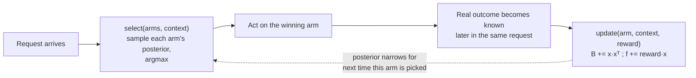
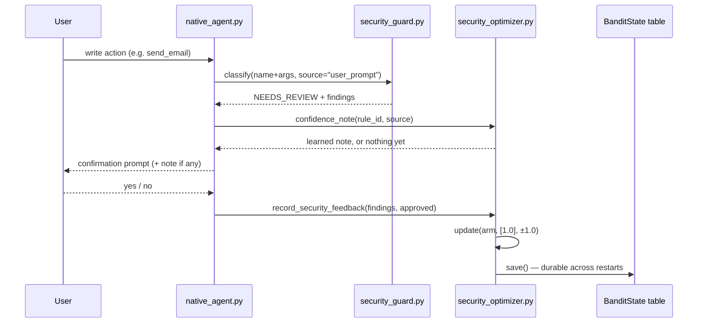

# ALGO AKANADE — RL Algorithms, Flow, and the Math

Every learning loop in this system, with the actual formulas each one
computes. This complements `README_ARROW_DIAGRAMS.md` (pictures, no
math) and `README_EXPLAINED.md` (prose, line-by-line code walkthrough).

**Worth knowing if you're comparing against other routers/gateways**:
OpenRouter's own docs describe deterministic price/latency-weighted
provider selection, and LiteLLM's router picks from explicit named
strategies (least-busy, cost-based) — neither maintains a learned
posterior that updates from real outcomes the way every algorithm below
does. CrewAI and AutoGen/AG2 have no built-in adaptive routing either
(the "RL" that turns up searching either one is a separate external
training project, not a native routing capability). See `README.md`'s
"How ALGO AKANADE compares" table for the full picture.

## 0. The formal objective everything below approximates

Reinforcement learning, in general, seeks a policy π maximizing expected
discounted return:

```
π* = argmax_π  E[ Σ_t γ^t R_t ]
```

Every bandit in this codebase is the **γ → 0** special case: a single
decision, one immediate reward, no multi-step planning. That's a
deliberate scope choice (see `gmaofn/router.py`'s module docstring) — a
full MDP solver (Q-learning, PPO) over an entire multi-turn task is the
natural next step and is left as a pluggable strategy, not implemented
twice. The one place this repo does something genuinely closer to
full RL is the nightly PEFT fine-tune (§7 below), which updates real
model weights rather than picking between existing options.

## 1. The shared primitive — linear contextual bandit via Thompson Sampling

Source: Agrawal & Goyal, *"Thompson Sampling for Contextual Bandits with
Linear Payoffs,"* ICML 2013. Implemented once in `gmaofn/bandit.py`'s
`LinearBanditCore`, reused by every layer in §2-§6 below.

**Model.** For each arm *a*, maintain a Bayesian linear regression
posterior over "reward given context vector x":

```
reward | x  ~  N(θ_aᵗx, σ²)
θ_a  ~  N(μ_a, ν² B_a⁻¹)
```

**State kept per arm** (accumulated from every past `(x, reward)` pair
that arm has actually received):

```
B_a = Σ x xᵗ + λI        (λ = ridge prior strength — LinearBanditCore's `ridge`)
f_a = Σ r·x
μ_a = B_a⁻¹ f_a           (posterior mean)
```

**Selecting an arm** (`LinearBanditCore.select`): for every candidate
arm, sample a fresh weight vector from its own posterior and score the
current context against it —

```
θ̃_a ~ N(μ_a, ν² B_a⁻¹)          (ν = exploration_scale)
choose  argmax_a  θ̃_a · x
```

Sampling — rather than always using μ_a directly — is what gives
Thompson Sampling its exploration: an arm with a wide (uncertain)
posterior occasionally wins even when its mean looks worse, so it keeps
collecting data instead of being starved by one early bad outcome. As
more `(x, reward)` pairs accumulate, `B_a` grows, the posterior narrows,
and the sampled θ̃_a converges toward the true μ_a.

**Updating after an outcome** (`LinearBanditCore.update`):

```
B_a ← B_a + x xᵗ
f_a ← f_a + r·x
```

**Cold start.** `ensure()` seeds a brand-new arm's posterior *mean* at a
hand-designed `seed_utility` while leaving the posterior *width* at its
widest (`B_a = λI`) — a prior that's easily overridden by the first few
real outcomes, never a claim of actual evidence.

**The loop, pictured** — every one of §2-§7 and §11 below is this exact
shape, just a different arm set/context/reward:



**Persistence** (`app/framework/bandit_persistence.py`, new) — every
arm's `(B, f)` is small enough to snapshot into the same PK/SK document
store `OAuthConnections`/`ChatSessions` already use (a new `BanditState`
table — see `README_DATA_MODEL.md`), so learning survives a process
restart instead of resetting to a blank prior every redeploy. §11's
`security_optimizer` is the first, currently-wired example
(`LinearBanditCore.to_state()`/`load_state()` do the actual (de)serialization);
any of §2-§7 can adopt the identical two-call pattern
(`bandit_persistence.load(name, self._core)` in `__init__`,
`.save(name, self._core)` after `update()`) with zero changes to this
module.

## 2. Agent routing — `gmaofn/router.py`

Picks which registered **agent** should handle a task, once per
completed task (not per model call).

**Context vector** `TaskContext.as_vector()` — 6 features:

```
x = [ complexity(0-1),
      context_size / 8000  (clamped to 1),
      latency_requirement_s / 60  (clamped),
      budget_usd / 5  (clamped),
      requires_rag(0/1),
      len(required_capabilities) / 5  (clamped) ]
```

**Cold-start prior** — before an agent has any observed reward, its
posterior mean is seeded from a hand-designed utility score:

```
U(a|T) = w1·Q(a,T) + w2·R(a) + w3·C(a,T) + w4·F(a,T) − w5·Cost(a) − w6·Latency(a)

w1=0.30 (predicted quality)   w2=0.20 (historical reliability)
w3=0.25 (capability match)    w4=0.10 (feedback-derived performance)
w5=0.10 (cost)                w6=0.05 (latency)
```

**Reward** — see §7's `R` formula below, computed per agent using its
Shapley-attributed share (§6) when multiple agents jointly worked the
task.

## 3. Framework picker — `agent/framework_stats.py`

Picks native vs LangGraph vs ADK for the next incoming task. Same
Thompson Sampling core, softmax-flavored arm scoring over each track's
observed (latency, error) history for same-shaped tasks — every track
implements the *identical* §6.1 algorithm (the §6.5 equivalence
requirement), so this bandit is purely picking the fastest/most-reliable
*implementation* of the same behavior, never trading off correctness.

## 4. Generation-parameter tuning — `llm/optimization_router.py`

Picks a real combination of request-level generation parameters
(temperature/top_p/max_tokens) **on every single model call** — the
fastest-cycling bandit in this repo.

**Context** — 2 features, one-hot on tier:

```
x = [ 1.0 if tier == "realtime" else 0.0,
      1.0 if tier == "bulk"     else 0.0 ]
```

**Arms** — `balanced` (no override), `low_latency` (greedy, capped
tokens), `high_quality` (warmer sampling, longer budget). Namespaced
`"{provider}::{arm}"` internally so one shared `LinearBanditCore`
learns each provider's own posterior independently.

**Reward:**

```
norm_latency = min(latency_ms / latency_budget_ms, 1.0)
reward = (1.0 if ok else −0.5) − 0.5 · norm_latency
```

## 5. Tool-schema size — `llm/token_optimizer.py`

Picks how many tool schemas to send to the **local Ollama rung only** —
every other provider is untouched.

**Context** — 2 features:

```
x = [ optional_tool_count / 40  (clamped),
      message_word_count  / 60  (clamped) ]
```

**Arms:** `full` (no cut), `top12`, `top6`, `top3` — ranked by keyword
overlap with the user's message; `DESTRUCTIVE` + every MCP tool are a
**guardrail floor**, never counted against the cut.

**Reward**, computed once the real turn outcome (not just the HTTP
call) is known:

```
saved_frac = max(0, (tokens_before − tokens_after) / tokens_before)
reward = (1.0 if success else −0.5) + 0.3 · saved_frac
```

## 6. RAG source + algorithm — `gmaofn/rag_optimizer.py`

Picks which knowledge store AND which retrieval algorithm to use for a
given query.

**Context** — 2 features:

```
x = [ candidate_arm_count / 10  (clamped),
      query_word_count     / 30  (clamped) ]
```

**Arms** — every real `"{store}::{algorithm}"` combination, e.g.
`pm-index::hybrid`, `default::lexical_rerank`. Algorithms:

- `vector` — pure embedding-similarity ranking (as the store returns it)
- `lexical_rerank` — re-ranks a wider candidate pool by real
  keyword/Jaccard overlap with the query
- `hybrid` — blended score:
  `0.5 · (vector_score / max_vector_score) + 0.5 · lexical_overlap`

**Reward:**

```
reward = −0.5                        if n_hits == 0
       = 1.0 if success else −0.2    otherwise
```

An empty retrieval is penalized regardless of anything else that
happened — a store/algorithm pair that finds nothing is a bad pick no
matter what the rest of the turn did.

## 7. Local vs hosted model — `llm/hybrid_router.py`

Picks, per message, whether to prefer the free local SLM or a hosted
model — "Hybrid" mode in the UI.

**Context** — 3 features:

```
x = [ word_count   / 50  (clamped),
      clause_count /  4  (clamped),
      1.0 if tier == "delay_ok" else 0.0 ]
```

**Arms:** `local` (prefer Ollama) vs `hosted` (no override — the
normal chain already tries hosted rungs first).

**Reward**, asymmetric on purpose:

```
reward =  1.0   if arm == "local"  and success
       = −0.6   if arm == "local"  and not success
       =  0.5   if arm == "hosted" and success
       = −0.3   if arm == "hosted" and not success
```

A local success outranks a hosted success (free AND it worked); a
local *failure* is penalized harder than a hosted one — routing
something local couldn't handle wastes a whole turn a hosted model
would likely have gotten right the first time.

## 8. Multi-agent credit — the Shapley value

Source: Lloyd Shapley, 1953 (2012 Nobel Memorial Prize in Economic
Sciences, cooperative game theory). Used in `gmaofn/shapley.py` to split
ONE observed task reward fairly across however many agents jointly
produced it, *before* that credit reaches each agent's bandit posterior
(§2) — without this, a naive scheme either dumps the whole reward on the
last agent in a pipeline, or splits evenly regardless of actual
contribution.

For a coalition of agents *N* with characteristic (value) function
*v(S)* — "how good is the outcome if only the agents in subset S had
participated" — agent *i*'s Shapley value is the average of its marginal
contribution over every possible arrival order:

```
φ_i(v) = Σ_{S ⊆ N∖{i}}  [ |S|! (|N|−|S|−1)! / |N|! ] · ( v(S ∪ {i}) − v(S) )
```

**Characteristic function** — a noisy-OR over each agent's standalone
quality (superadditive: two mediocre agents together are worth more
than either alone, but not simply their sum):

```
v(S) = 1 − Π_{i ∈ S} (1 − quality_i)
```

Computed exactly (2ⁿ subsets) up to `_EXACT_LIMIT` agents; beyond that,
the standard Monte Carlo permutation estimator — shuffle agent order,
accumulate each agent's marginal contribution as it's "added" to the
running coalition, average over many shuffles — the same approximation
SHAP and other applied-Shapley tools use at scale.

## 9. Reward + adaptive weights — `gmaofn/reward.py`

The task-level reward every Shapley-attributed share (§8) feeds into
agent routing (§2):

```
R = α·Quality + β·Success + γ·UserFeedback − δ·Cost − ε·Latency − ζ·Failure
```

`α..ζ` (`RewardWeights`) start at `0.30 / 0.25 / 0.20 / 0.10 / 0.10 /
0.05` and are **adaptively updated**, REINFORCE-style, rather than fixed
forever:

```
AdaptiveWeights.update(outcome, R):
    each coefficient drifts toward whichever term most consistently
    co-occurred with a HIGH R, and away from whichever co-occurred
    with a LOW one, then all six are renormalized so they always sum
    to 1 (a probability simplex over "what matters right now")
```

Deliberately simple and auditable — `weights.snapshot()` lets an
operator see exactly why routing shifted, rather than a second
black-box model layered on top of the router's own bandit.

## 10. The one non-bandit loop — nightly PEFT fine-tune

`scripts/finetune_local_slm.py` is a different kind of learning
entirely: real gradient descent on real model weights (LoRA adapters),
not a routing choice among fixed options.

**Per-turn reward** (`app/agent/finetune_log.py`), computed once, at
log time, from a simple deterministic heuristic:

```
reward = 1.0
reward -= 0.3   if the turn needed a retry (output_guard rejected the
                  first attempt)
reward -= 0.5   if the turn was flagged out_of_scope
reward = clamp(reward, 0, 1)
```

**Reward-weighted loss** — the "RL-informed" half of "reward-weighted
supervised fine-tuning," a CPU-tractable stand-in for full online RL
(PPO-style rollouts, which need a live reward model and thousands of
rollouts per update — not remotely practical without a GPU):

```
per_example_loss_i = standard cross-entropy on the assistant's
                      final turn only (loss masked to -100 elsewhere)

weighted_loss = Σ_i (per_example_loss_i × reward_i)  /  Σ_i reward_i
```

A reward-1.0 example teaches more than a reward-0.7 one; nothing below
the `--min-reward` threshold (default 0.7) is used at all.

**Promotion gate** — the trained result never reaches production on its
own reward alone; it must also beat the currently-served model on the
candidate-selection harness (`scripts/eval/regression_gate.py`, see
`README_ARROW_DIAGRAMS.md` §9/§11) before being registered.

## 11. Security findings — `app/security_optimizer.py`

The newest layer, and the only one wired into §1's persistence
mechanism today. Unlike §2-§7, this one deliberately does NOT decide an
action — it only learns a CONFIDENCE NOTE on top of a decision
`app/security_guard.py` already made deterministically. See
`README_CYBERSECURITY.md` for the full threat model this protects
against.

**Arms**: `"{SEC-rule-id}::{source}"` — one posterior per (deterministic
rule, text surface) pair, e.g. `"SEC-UNAUTHORIZED-ACTION::user_prompt"`.

**Context**: constant `[1.0]` — no per-call features yet (unlike §2-§7's
query-length/latency-shaped contexts); the bias term alone is the whole
learned estimate for now.

**Reward** — real, not synthetic, and narrower in scope than any other
layer here: only a write action whose confirmation prompt carried a 🟡
NEEDS_REVIEW finding produces a signal at all, from the user's actual
yes/no answer to THAT confirmation:

```
reward = +1.0   if the user answered "no" (declined) —
                 evidence the flagged rule actually mattered
reward = −1.0   if the user answered "yes" (proceeded anyway) —
                 evidence it was a nuisance for this case
```

**What it's NEVER used for**: deciding whether a rule fires (that's
`security_guard.py`'s sole, deterministic authority), or anything at the
🔴 RISK tier (RISK blocks outright, before a confirmation prompt — and
therefore before this layer — is ever reached). `confidence_note()`
only ever ADDS a parenthetical to an existing confirmation prompt; it
never changes whether one is required.



## 12. Provider ordering — `llm/provider_optimizer.py`

Closes a real gap the earlier revision of this file's own §"Model tiers"
documentation carried: `CHAINS` (`llm/router.py`) — "realtime: Luna →
Groq → Deepseek → Ollama → rule-based" — used to be the LIVE fallback
order, not just a cold-start default. Every call for a given tier tried
the exact same provider first, forever, regardless of which one had
actually been fastest/most reliable in practice — a real, hand-written
rule masquerading as "the router decides." This layer makes it actually
decide.

**Arms**: `"{tier}::{provider}"` — one posterior per (tier, provider
registry key) pair, e.g. `"realtime::groq"`. The deterministic `rule`
floor is NEVER an arm — `record_outcome()` ignores it outright, and
`order()` always places it last regardless of any other arm's sampled
score, so a cold or unlucky posterior can never rank the non-LLM
fallback ahead of a real model.

**Context**: constant `[1.0]`, same shape as §11's security layer — no
per-call features yet.

**Selection — a full RANKING, not just one winner**: every candidate
provider gets ONE fresh Thompson-Sampled draw from its own posterior,
and the whole chain is sorted by that sample, highest first —
`LinearBanditCore.select()`'s single-winner logic, extended to "what
order should we try ALL of these in." Cold-start `seed_utility` biases
toward the ORIGINAL `CHAINS` position (earlier in the hand-written list
seeds higher), so a freshly-deployed system's behavior matches today's
list exactly, and only drifts once real evidence justifies it.

**Reward** — real HTTP-level success/failure from `TierClient.chat()`'s
own try/except, plus a real (capped) latency penalty, mirroring §7's
local-vs-hosted shape:

```
reward = 1.0   if the call succeeded
reward = −1.0  if it raised (network/5xx/timeout)
reward −= min(latency_ms / 10_000, 0.3)   (capped latency penalty either way)
```

**What this NEVER overrides**: an explicit `preferred` (a user's own
model pick via the UI, or Hybrid mode's §7 local/hosted choice) is
applied AFTER this reorder and still wins outright, unconditionally —
this layer only decides the order of the REST of the chain, the
fallback behind whatever was explicitly requested.

**A real bug this surfaced and fixed along the way**: wiring this in
required threading the provider's REGISTRY key ("luna", "ollama")
through `TierClient.chat()`'s loop instead of the provider's `.name`
display string ("gpt-5.6-luna", "ollama-llama3.2:1b") — two different
namespaces that were being silently compared against each other
(`p.name == self.preferred`) for the `preferred_timeout`/
`preferred_escalated` checks. Since `self.preferred` is always a
registry key, that comparison was `False` for every BUILT-IN provider,
meaning Hybrid mode's own escalation-timeout mechanism (§7) had never
actually been shortening Ollama's timeout, and
`finetune_log.log_hybrid_escalation_turn()` had never actually been
firing — a real, silent gap in a previously-shipped feature, closed as
a side effect of giving this layer a consistent key to work with.

## Summary table

| # | Layer | Arms / decision | Context dims | Reward formula | Persisted? |
|---|---|---|---|---|---|
| 2 | Agent routing | any registered agent | 6 | Shapley-attributed `R` (§9) | No |
| 3 | Framework picker | native/langgraph/adk | latency/error history | softmax over same | No |
| 4 | Generation params | balanced/low_latency/high_quality | 2 | `(1 or −0.5) − 0.5·norm_latency` | No |
| 5 | Tool-schema size | full/top12/top6/top3 | 2 | `(1 or −0.5) + 0.3·tokens_saved_frac` | No |
| 6 | RAG source+algorithm | every store×algorithm pair | 2 | `−0.5` if empty, else `1 or −0.2` | No |
| 7 | Local vs hosted | local/hosted | 3 | `1 / −0.6 / 0.5 / −0.3` | No |
| 10 | Model weights (PEFT) | *(not a bandit)* | — | reward-weighted cross-entropy | Yes (checkpoint on disk) |
| 11 | Security findings | `"{SEC-rule}::{source}"` | 1 (constant) | `+1.0` declined / `−1.0` approved | **Yes** (`BanditState` table) |
| 12 | Provider ordering | `"{tier}::{provider}"` | 1 (constant) | `±1.0` success/failure, minus a capped latency penalty | **Yes** (`BanditState` table, throttled) |

Rows 2-7 all reuse the exact same `LinearBanditCore` math (§1); only the
arm set, context features, and reward formula differ. Row 10 is genuine
weight-space learning and is deliberately the slowest, most expensive,
most gated of them all. Rows 11 and 12 are the two bandit-shaped rows
with durable persistence wired up today (§1's "Persistence" note) — row
12 throttles its saves (every 20 updates, not every call) since it
updates on EVERY LLM call, far more often than row 11's confirmation-
driven updates; rows 2-7 can adopt the identical persistence mechanism
without any change to `bandit.py`/`bandit_persistence.py`.
