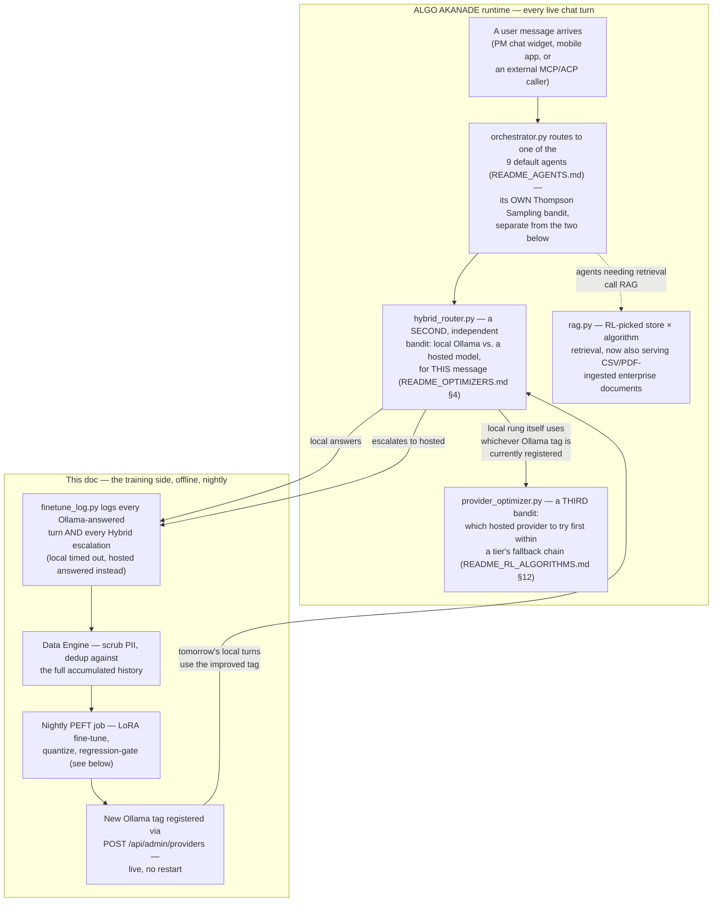

# The local SLM pipeline — Enterprise Data → Data Engine → Base SLM → ... → Enterprise Software

Every stage of the local-model pipeline, what it actually does in this
codebase, and which file owns it — the "how does raw usage/enterprise
data actually turn into a better local model" story end to end. For the
per-message Hybrid-mode routing decision (which turn goes to the local
model at all), see `ARCHITECTURE.md` §8 and `README_OPTIMIZERS.md` §4;
this doc is specifically the training/data side.

## The whole pipeline, one diagram

```
   ╔══════════════════════════════════════════════════════════════════╗
   ║   ALGO AKANADE runtime — every live chat turn passes through here,      ║
   ║   producing the "real chat usage" this pipeline trains on          ║
   ╚══════════════════════════════════════════╤═════════════════════╝
                                              │ orchestrator.py routes to
                                              │ 1 of 9 agents, hybrid_router.py
                                              │ decides local Ollama vs. hosted
                                              ▼
                    Enterprise Data
             (real chat usage + ingested
              CSV / PDF / TXT / MD files)
                          │
                          ▼
              ┌─────────────────────────┐
              │ Collect enterprise       │  YOUR curated prompt list —
              │ prompts                  │  questions the business
              └────────────┬─────────────┘  actually cares about
                          │
                          ▼
              ┌─────────────────────────┐
              │ Create ground truth      │  framework/ground_truth.py
              │ (grounded + reviewed)    │  POST /api/v1/rag/ground-truth
              └────────────┬─────────────┘  — DELIBERATE, not incidental
                          │
                          ▼
                  ┌───────────────┐
                  │  Data Engine  │  scripts/data_engine.py
                  │  scrub PII +  │  agent/finetune_log.py
                  │  persistent   │
                  │  dedup store  │
                  └───────┬───────┘
                          │
                          ▼
                  ┌───────────────────┐
                  │     Base SLM      │  Ollama — config.py's
                  │ Qwen / SmolLM /   │  OLLAMA_MODEL, default
                  │ Llama, 0.6B–4B    │  llama3.2:1b, deploy
                  └─────────┬─────────┘  bumps to qwen2.5:3b
                          │
                    LoRA / QLoRA          scripts/finetune_local_slm.py,
                          │              run nightly by deploy/nightly_
                          │              finetune.sh — see §4b below
                          ▼
                  ┌───────────────────┐
                  │    Domain SLM     │  reward-weighted
                  │    (fine-tuned)   │  supervised fine-tune
                  └─────────┬─────────┘
                          │
              Quantization / Pruning     GGUF/Q4_K_M (real) +
                          │              torch.nn.utils.prune (real,
                          ▼              opt-in, honest limitation)
                  ┌───────────────────┐
                  │  Algo-Akanade-SLM │  scripts/convert_and_
                  │  (4-bit, your own │  register_ollama_model.sh
                  │  branded model)   │  tag: algo-akanade-slm:<date>
                  └─────────┬─────────┘
                          │
              ┌───────────┴────────────┐
              ▼                        ▼
             RAG                    Agents
      (rag.py, RL-picked      (9 default agents,
       store × algorithm)      Thompson Sampling router)
              │                        │
              └───────────┬────────────┘
                          ▼
                  Enterprise Software
              (the PM chatbot / ALGO AKANADE's
                    /api/v1/* surface)
                          │
                          │ POST /api/admin/providers registers the new
                          │ Ollama tag — hybrid_router.py's "local" arm
                          │ uses it on the very next message, no restart
                          ▼
   ╔══════════════════════════════════════════════════════════════════╗
   ║   ...back to the SAME ALGO AKANADE runtime box at the top — this is a   ║
   ║   CLOSED LOOP, not a one-shot pipeline. See the next section for   ║
   ║   exactly which ALGO AKANADE components sit on which side of it.        ║
   ╚══════════════════════════════════════════════════════════════════╝
```

## How ALGO AKANADE fits around this pipeline — the closed loop

Everything above is the TRAINING side. It doesn't run in isolation —
it's one half of a loop that closes through ALGO AKANADE's actual runtime
components (`README_AGENTS.md`, `README_RL_ALGORITHMS.md`), each of
which is a SEPARATE bandit/mechanism from the ones this doc already
covers — worth being explicit about which is which, since three
different "which model/agent wins" decisions exist in this codebase and
conflating them is an easy mistake:



- **Three bandits, three different decisions** — don't conflate them:
  `orchestrator.py`'s router picks WHICH AGENT (of 9) handles a task;
  `hybrid_router.py` picks LOCAL VS. HOSTED for a single message once an
  agent's already decided to call a model; `provider_optimizer.py` then
  orders the HOSTED fallback chain if hosted was picked. All three reuse
  the same `LinearBanditCore` math (`README_RL_ALGORITHMS.md` §1) but
  keep entirely separate posteriors — an agent-routing decision never
  feeds the local/hosted bandit's learning, and vice versa.
- **The loop closes through a config change, not a code change.** The
  nightly job's output is a NEW Ollama tag (`qwen2.5-tuned:20260827`,
  say) — `hybrid_router.py`'s "local" arm keeps pointing at whichever
  tag `config.py`'s `OLLAMA_MODEL` (or the Admin AI Models UI) currently
  names. Promoting a fine-tune is changing that pointer, exactly the
  same mechanism as adding any other provider — never a redeploy.
- **RAG and the training pipeline share a document source, not a
  bandit.** `framework/rag.py`'s own store×algorithm bandit is
  unrelated to any of the three above — it's listed here only because
  ingested CSV/PDF documents (pipeline stage 1) feed both RAG retrieval
  AND, via `log_document_turn()`, the training data.

## Stage by stage — what's real, what file owns it

### 1. Enterprise Data

Two real sources feed the pipeline, not one:

- **Real chat usage** — every turn the local Ollama model actually
  answers, plus every Hybrid-mode escalation (local timed out, a hosted
  model answered instead — that answer is a real, worked example of
  what the local model should have done itself). Logged by
  `agent/finetune_log.py`'s `log_ollama_turn()` /
  `log_hybrid_escalation_turn()`.
- **Ingested documents** — CSV, PDF, TXT, and MD files under
  `RAG_INGEST_DIR` (`framework/document_pipeline.py`'s `ingest_path()`).
  CSV rows render as `field: value, field: value` text
  (`_extract_csv`); PDFs extract real per-page text via `pypdf`
  (`_extract_pdf`) — a genuine optional dependency, with a clear,
  actionable skip reason ("pip install pypdf") if it's missing, never a
  crash. When a summary or follow-up prompts generated from ingested
  content is actually answered by the local Ollama rung,
  `log_document_turn()` logs that grounded Q&A too (reward 0.9 — strong
  signal, but without the retried/out_of_scope check a live chat turn
  gets, so a hair below the 1.0 a clean chat answer earns).

Both sources above are INCIDENTAL — whatever happened to get asked.
Two more stages make the corpus DELIBERATE instead:

### 1b. Collect enterprise prompts

Not a piece of code — this is you, or whoever owns the fine-tune,
writing down the real questions the business actually wants the local
model to get right (a support team's most common tickets, a sales
team's recurring objections, the ten things new hires always ask). The
list itself is just `list[str]`, the input to the next stage.

### 1c. Create ground truth (`framework/ground_truth.py`,
`POST /api/v1/rag/ground-truth`, Admin-only)

For each collected prompt: optionally retrieve real grounding context
from any already-registered store (an ingested CSV/PDF corpus, or
`pm-index`) via the SAME `rag_optimizer.retrieve_with_optimizer()`
pipeline `summarize_document()`/`suggest_prompts()` already use, then
ask the LLM router's `"bulk"` tier for one precise, reviewable answer —
grounded ONLY in the retrieved excerpts when a store is given, general
knowledge otherwise. Every result is returned to the caller for review
BEFORE anything is trusted, exactly like a summary. Only calls that
actually succeeded get logged, via a NEW `finetune_log.py` function,
`log_ground_truth_turn()` — fixed reward `1.0`, the highest of any
logger here, and deliberately **not** gated to `provider.startswith
("ollama")` the way `log_ollama_turn()` is: the whole point is
distilling from whichever model produced the best verified answer
(often a stronger hosted tier), the same "teach the local model from
what actually worked" reasoning `log_hybrid_escalation_turn()` already
established. The logged messages include the retrieved context as a
system message when grounded — matching what real RAG-augmented
inference actually looks like — but never this stage's own "produce
verified training data" instruction, which the model will never
actually see in production.

### 2. Data Engine (`scripts/data_engine.py`)

The real curation step between raw logged data and what actually trains
the model — and, deliberately, a **persistent, ever-growing store**, not
a value recomputed from scratch each night:

- **`scrub_pii()`** — redacts email addresses, API-key-shaped tokens,
  credit-card numbers, SSNs, and phone numbers from every example
  *before* it can ever be baked into model weights. This has to happen
  upstream of the actual gradient step — unlike a logging/display-layer
  redaction, a fine-tuned model can't un-learn a secret it was trained
  on.
- **`DataEngineStore`** — dedupes each new example against **every
  example this store has ever kept**, not just tonight's batch (cosine
  similarity on a cheap hashed bag-of-words vector, `--dedup-threshold`
  configurable). A prompt logged Monday still blocks its near-duplicate
  from being re-added Thursday. Only genuinely new examples are
  appended to the durable JSONL corpus (`--curated-path`); `ingest()`
  returns exactly what was added.
- `finetune_local_slm.py` trains on the curated store's full
  accumulated contents (capped at `--max-examples`, most recent first),
  not a single night's raw log — `--no-data-engine` bypasses all of
  this for a quick local test run only; the nightly cron should not set
  it.

### 3. Base SLM

Ollama, configured via `config.py`'s `OLLAMA_MODEL` — defaults to
`llama3.2:1b`, with `deploy/update_containers.sh` bumping it to
`qwen2.5:3b` for the real deployed box. Both are comfortably inside the
0.6B–4B range this pipeline targets; any other Ollama-hosted model
(a different Qwen/Llama size, or another small open model) works via
the same config, no code change.

### 4. LoRA / QLoRA (`scripts/finetune_local_slm.py`)

- **LoRA** (default, CPU-friendly) — `r=8, alpha=16` adapters on the
  attention + MLP projections, reward-weighted loss
  (`RewardWeightedTrainer`): a 1.0-reward example teaches more than a
  0.7-reward one, not identically. Bounded by `--max-minutes`
  wall-clock, the real safety cutoff on an unattended nightly job (step
  count alone doesn't reliably bound CPU wall-clock time).
- **QLoRA** (`--qlora`, opt-in) — loads the base model 4-bit via
  `bitsandbytes` (`nf4`, double-quant) instead. Needs a real CUDA GPU —
  bitsandbytes' 4-bit kernels don't run on CPU — and refuses cleanly
  with an actionable message if requested without one, rather than a
  cryptic crash deep inside bitsandbytes. Not installed by default (see
  `finetune_requirements.txt`'s comment) since it only does anything
  useful on a GPU box, unlike everything else in that file.

**Which hyperparameters to use — the 10th real optimizer
(`scripts/peft_hyperparam_optimizer.py`, `--auto-hyperparams`).** Every
OTHER "which option, learned from outcomes" decision in this codebase
is the same `LinearBanditCore` Thompson Sampling primitive
(`README_RL_ALGORITHMS.md`); the hyperparameters above were the one
fixed exception — `lora_r=8`, `alpha=16`, `min_reward=0.7`, chosen once
and never revisited. `--auto-hyperparams` closes that gap: a bandit
over three named presets (`conservative` / `balanced` / `aggressive` —
bundling rank+alpha+reward-threshold together, since they interact)
picks tonight's configuration from context = [curated example count,
average reward], and `scripts/eval/regression_gate.py --update-peft-bandit`
feeds its own `new_score - old_score` margin back as the reward once
tonight's fine-tune has actually been scored — the SAME regression gate
that decides whether to promote it. Off by default (the fixed values
above are unchanged unless both flags are set); persisted to a plain
JSON file (`--peft-bandit-state`), not `bandit_persistence.py`'s
DynamoDB-backed store, since this standalone script has no access to
the live app's database. 11 tests in `test_peft_hyperparam_optimizer.py`,
including that a repeatedly-winning arm is picked more often after a
fresh process reloads the persisted state from disk.

### 4b. The nightly job, mechanically (`deploy/nightly_finetune.sh`)

Stages 4 through 7 above describe what the training/quantization math
*does*; this is how it actually gets RUN, unattended, every night, on
the real deploy box:

```
crontab: 30 3 * * *  /opt/algo-kaizen/nightly_finetune.sh
                          │
                          ▼
          docker cp ak-chatbot:/srv/data/finetune/ollama_turns.jsonl
          (pulls today's log straight out of the LIVE chatbot
           container — no separate export step, no shared volume)
                          │
              no log yet? ──────► exit 0, log "nothing to do tonight",
              (first night, or                touch nothing already serving
               local SLM never answered)
                          │
                          ▼
          docker run algo-kaizen-finetune  (deploy/Dockerfile.finetune —
                                             a SEPARATE image from the
                                             three deployed ak-* services,
                                             built once, reused nightly)
              scripts.finetune_local_slm
                --log-path .../ollama_turns.jsonl
                --base-model Qwen/Qwen2.5-1.5B-Instruct   (FINETUNE_BASE_MODEL)
                --max-minutes 120                          (FINETUNE_MAX_MINUTES)
                          │
              too few reward≥threshold examples? ──► no merged/ dir produced,
              (Data Engine's dedup can starve            skip conversion, exit
               a quiet night down to zero)                cleanly, log why
                          │
                          ▼  (merged/ exists)
          scripts/convert_and_register_ollama_model.sh
              GGUF convert → llama-quantize Q4_K_M →
              new tag qwen2.5-tuned:<UTC-date> (base tag untouched) →
              sanity check ("does it answer at all") →
              eval/regression_gate.py vs. the CURRENT base tag,
              same harness that picked the base model originally
                          │
              fails the gate? ──────► tag exists on disk but is NEVER
                                       registered — tonight's run is a
                                       no-op from the running system's
                                       point of view
                          │
                          ▼ (passes)
          POST /api/admin/providers  — live, selectable, no restart;
          hybrid_router.py's "local" arm starts using it on the very
          next message that arm is picked for
                          │
                          ▼
          retention: keep only the last 3 nights' out/<date>/ directories
          on disk (multi-GB checkpoints — this alone stops the deploy
          box quietly filling up over weeks)
```

Every failure mode above — no data, no image, too little new data, a
failed regression gate — exits cleanly and changes nothing already
serving; the only way tonight's run ever changes runtime behavior is by
successfully clearing every one of those gates and reaching the
`POST /api/admin/providers` call. `LOG=/opt/algo-kaizen/logs/ak-finetune.log`
captures the full run (stdout+stderr) for a human to check in the
morning — this job pages nobody and blocks nothing if it fails silently
overnight, on purpose.

### 5. Domain SLM

The merged result of step 4 — `model.merge_and_unload()`, a plain HF
model directory. This is the point where the base model has genuinely
learned from this deployment's own real usage.

### 6. Quantization / Pruning

- **Quantization** (always, via the follow-on script) — GGUF f16 →
  `llama-quantize` → Q4_K_M. This is what actually ships to Ollama.
- **Pruning** (`--prune-sparsity`, opt-in, default `0.0`/off) — real
  global L1-unstructured magnitude pruning (`torch.nn.utils.prune`, no
  new dependency) over every linear layer, with `prune.remove()` making
  it permanent so the zeros survive `save_pretrained()`. The actual
  measured sparsity is printed after, not just the requested fraction.
  **Honest limitation, stated in `prune_model()`'s own docstring**: the
  GGUF/Q4_K_M quantizer above does not specially exploit exact zeros
  for a smaller or faster result today — this is a real, verifiable
  transform without a proven inference-time win through *this* serving
  path yet, which is exactly why it defaults off.

### 7. Algo-Akanade-SLM

`scripts/convert_and_register_ollama_model.sh` — GGUF conversion,
quantization, then an **export step**: the quantized GGUF + the
Modelfile that produced it + a `metadata.json` (base tag, quant type,
sanity-check/gate outcome, whether it was registered) are copied to
`exported_models/<tag>/` — a real, standalone, portable artifact
outside both the script's own temp dir and Ollama's opaque blob store,
kept even when a candidate fails, so it stays inspectable rather than
just vanishing. Then: a new Ollama tag (the base tag is never touched),
a sanity check ("does it answer at all"), then
`scripts/eval/regression_gate.py` compares the new tag against the base
tag on the SAME eval harness used to pick the base model in the first
place. Only a tag that passes ever reaches `POST /api/admin/providers`
as `"algo-akanade-slm"` — live, selectable, no restart. See
`README_SLM_GENERATION_LAYER.md` for the full layer writeup (what's
already used vs. what this adds) and a quickstart LoRA example
(`scripts/quickstart_lora_example/`) for experimenting outside the
full nightly Docker pipeline.

### 8. RAG + Agents

Both consume the now-improved local model exactly like before — nothing
downstream of "which Ollama tag answers" changes:

- **RAG** (`framework/rag.py`) — RL-picked store × algorithm retrieval,
  now also fed by CSV/PDF-ingested enterprise documents (step 1) via
  the same `VectorStoreAdapter` every other content source uses.
- **Agents** — ALGO AKANADE's 9 default agents (`README_AGENTS.md`), any of
  which can be routed to `get_llm_client(...)`'s local Ollama rung the
  same way `pm-agent` already is.

### 9. Enterprise Software

The PM chatbot and ALGO AKANADE's `/api/v1/*` orchestration API — the actual
consuming application every stage above exists to serve.

## Trying it locally

```bash
cd backend
pip install -r requirements.txt          # CSV/PDF ingestion works out of the box (pypdf)
python -m pytest tests/test_data_engine.py tests/test_document_pipeline.py -q

# The heavy training path — separate venv, see finetune_requirements.txt:
pip install -r scripts/finetune_requirements.txt
python scripts/finetune_local_slm.py --help
```

## What's verified vs. what still needs the real deploy box

Same honesty standard `finetune_local_slm.py`'s own module docstring
already holds itself to:

- **Fully test-verified** (pure Python, no heavy deps, real unit tests
  in the main suite): `data_engine.py`'s scrub/dedup/persistent store,
  `document_pipeline.py`'s CSV/PDF extraction and ingestion, and the
  `log_document_turn()` wiring from document Q&A into the fine-tune log.
- **Syntax-verified, smoke-tested on a tiny model, NOT yet run
  end-to-end on the real deploy box**: the Data-Engine-integrated
  training loop, `--prune-sparsity`, and especially `--qlora` (which
  additionally needs a CUDA GPU this pipeline was never validated
  against at all). Re-run once on the real box with real accumulated
  data before trusting any of the three unattended.
