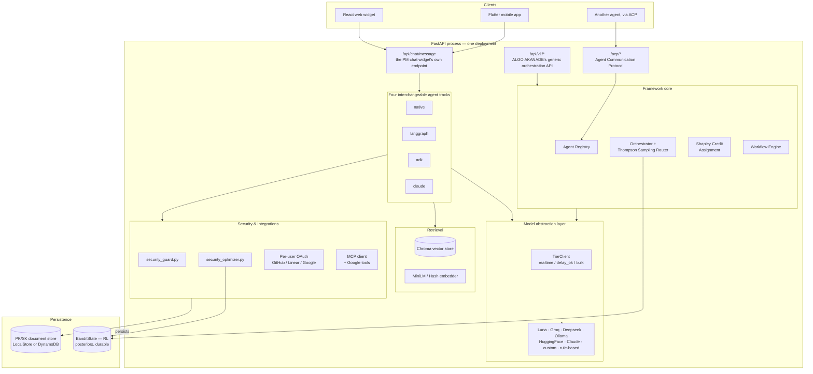
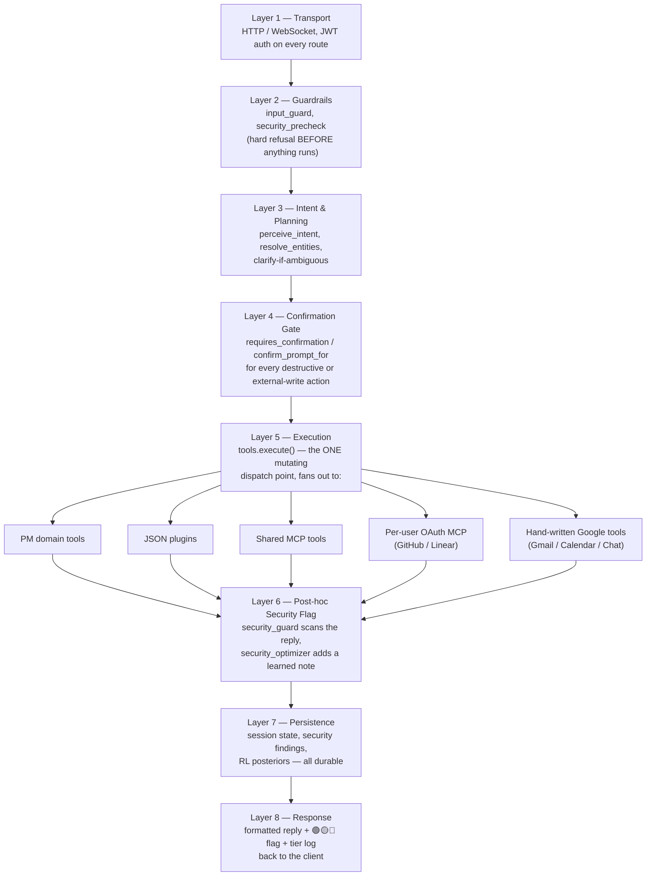
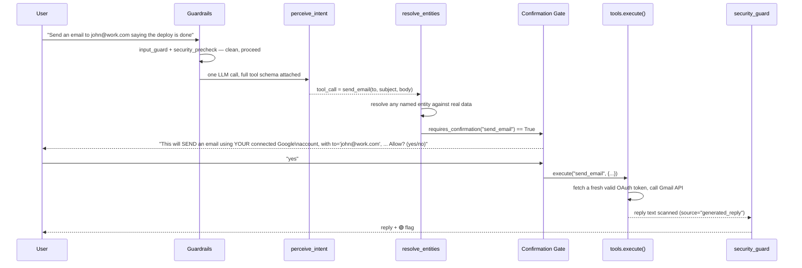
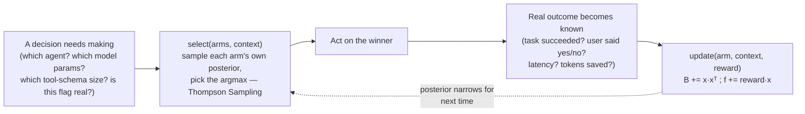
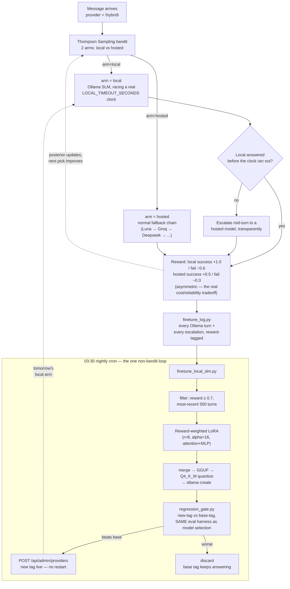
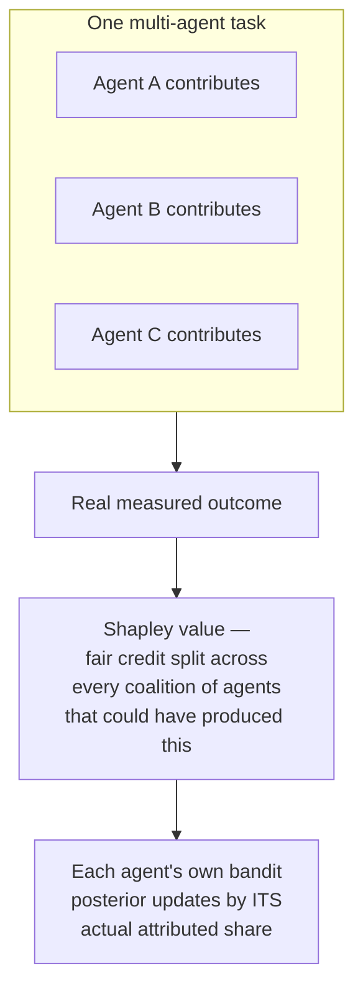

# The ALGO AKANADE Journey — Video Script & Deep-Dive Companion

**Purpose of this document**: a narration-ready script, with embedded
diagrams, meant to be fed into a video/podcast generation tool (e.g.
NotebookLM's "video overview" or "deep dive" feature) to produce a
~15-20 minute walkthrough of the entire ALGO AKANADE system. Every diagram
is real Mermaid — a generator can render it directly, or a narrator can
describe it live. Every technical claim below is grounded in real code
in this repository, not aspirational — where something is a *pattern*
rather than a *finished integration*, that distinction is called out
explicitly, on purpose, so the video never overclaims.

Suggested pacing for a longer, fully-detailed video is noted at each
section header (`⏱`). Total: ~34 minutes of narration at a natural
speaking pace, plus diagram dwell time — this expanded version trades
the original 15-20 minute target for full box-by-box architecture
coverage, the named "Algo AI Layer" auto-model-selection explainer, a
detailed 7-way competitor comparison table (OpenWorker, OpenRouter,
LiteLLM, CrewAI, AutoGen/AG2, LangGraph Platform), how the
UI/PM-backend/ALGO AKANADE pieces actually deploy and connect, the adaptive
MCP/ACP and Hybrid-mode deep dives, the data-security highlight, the
admin Security dashboard, and a full technology/file-structure
reference. For a tight 15-20 minute cut, keep sections 1, 1b, 2 (table
only, skip the per-competitor narration), 3 (diagram only, skip 3b's
per-box narration), 3c, 4, 6, 7, 7b, and 14, and skip
9b/9c/10b/10c/13/Appendix B. **For a short, executive-audience version,
use `VIDEO_SCRIPT_EXECUTIVE.md` instead — a separate 5-10 minute script
written for a non-technical/business audience.**

---

## 🎬 Cold Open ⏱ 0:00–0:30

**[VISUAL: ALGO AKANADE logo / title card, then a single chat bubble typing
"Create a task called Fix login bug, assign it to Rohan, due Friday"
and a reply appearing instantly]**

**NARRATION:**

> Somewhere between "just call the OpenAI API" and "build your own
> AGI lab," there's a real, practical question every team building an
> AI product eventually hits: how do you route a request to the right
> model, the right agent, the right tool — and get *better* at that
> routing over time, automatically, without a human re-tuning
> thresholds every week? This is the story of ALGO AKANADE: a system built
> to answer that question for real, in production, with real users.

---

## 1. What is ALGO AKANADE? ⏱ 0:30–1:30

**[VISUAL: The full name spelling itself out letter by letter]**

**NARRATION:**

> ALGO AKANADE stands for **Multi-Agent GenAI Network with Evolving
> Training and Orchestration**. Every word in that name is doing real
> work:
>
> - **Multi-Agent** — not one chatbot, a *registry* of independently
>   swappable agents, each declaring what it's good at.
> - **GenAI Network** — those agents, plus every model provider behind
>   them, form a network the system routes across, not a fixed
>   pipeline.
> - **Evolving Training** — the system doesn't just serve requests, it
>   *learns from the outcome of every one*, nightly fine-tuning its own
>   local model on the turns it handled best.
> - **Orchestration** — a real workflow engine underneath, capable of
>   sequential, parallel, hierarchical, consensus, fallback, and retry
>   execution patterns across multiple agents on one task.
>
> It started life under a different name — you'll see `gmaofn` in some
> older file paths, an artifact of the framework's original identity
> before this rename — but the architecture underneath has been
> consistent throughout.
>
> Concretely, it's one FastAPI process combining: a generic,
> domain-agnostic orchestration core; a first "tenant" application
> built on top of that core — a project-management assistant called
> `pm-agent`; a vendor-neutral model abstraction layer; a retrieval
> (RAG) layer; and now, a full security-and-integrations layer covering
> Gmail, Calendar, Google Chat, GitHub, and Linear.

---

## 1b. The Algo AI Layer — every prompt automatically finds its own model ⏱ 1:30–2:15

**[VISUAL: a single typed prompt, with three quick decision badges
lighting up in sequence: "Tier: realtime" → "Provider: Groq" →
"Params: low-latency"]**

**NARRATION:**

> One idea worth naming clearly, because it's the thing a user never
> sees happening: nobody ever picks a model for a given prompt. Every
> single message that comes in triggers the same three-step decision,
> automatically — call it the Algo AI Layer.
>
> First, a fast, free, local classifier — no model call at all — tags
> how urgent and how complex the request looks: a normal chat turn is
> realtime, an explicit report or digest ask is delay-ok, background
> work is bulk. Second, that tier's own real fallback chain decides
> *which* provider actually answers — Luna, then Groq, then Deepseek,
> then a local Ollama model, down to a fully offline floor — or, if
> Hybrid mode is on, this exact step is replaced by the learned local-
> versus-hosted bandit covered later in this video. Third, once a
> provider is chosen, one more learned decision picks the actual
> generation parameters for that specific call, tuned from real
> latency and success on that exact provider.
>
> Three real decisions, stacked, on every single prompt, with zero
> manual configuration required — and the deep math behind steps two
> and three is covered fully in sections six and ten-b.

---

## 2. How is this different from OpenWorker and "the rest out there"? ⏱ 2:15–5:15

**[VISUAL: A two-column comparison — "Typical coding-agent harness" vs
"ALGO AKANADE"]**

**NARRATION:**

> There's a real, fair comparison to make here, so let's make it
> honestly rather than just claiming to be better.
>
> Tools like OpenWorker are, at their core, **one harness around one
> model choice** — you pick a backend (local open-weight, or a hosted
> API), the harness gives that model tools, and you audit the harness
> because it's open source. That's a genuinely good idea, and ALGO AKANADE
> borrows the same instinct in its own security-agent design.
>
> But ALGO AKANADE's shape is different in three structural ways:
>
> **First — it's not one model, it's a *network* the system routes
> across automatically.** Every chat turn walks a real fallback chain
> — Luna, then Groq, then Deepseek, then a local Ollama model, down to
> a fully offline rule-based floor if every hosted provider is
> unreachable — and a reinforcement-learning layer decides, per call,
> which generation parameters, which tool-schema size, and even which
> *agent* should handle the task, learning from real outcomes instead
> of a human tuning weights.
>
> **Second — it's not one agent, it's a registry.** `pm-agent` is the
> first tenant, not the whole product. A coding agent, a general-purpose
> agent on the public Claude API, and three real security-scanning
> agents already sit in the same registry, competing for tasks that
> declare matching capabilities, scored by the exact same learning
> algorithm. Adding a new domain is one new file, not a fork.
>
> **Third — where OpenWorker's cybersecurity agents were a new
> announcement, ALGO AKANADE had already built the same *category* of
> capability independently, and pushed it further**: not just
> code-vulnerability scanning, but a real, no-API-key call to OSV.dev
> — Google's actual public vulnerability database — for every
> dependency in a `requirements.txt`, real Dockerfile/Kubernetes
> misconfiguration pattern-matching, and — new in this round — a
> security layer that doesn't just scan code, it scans *every chat
> turn*: the user's own prompt, and everything read back from a
> connected Gmail inbox, calendar, or chat — flagged 🟢🟡🔴, with a
> reinforcement-learning layer that gets *better at knowing which
> flags actually mattered*, from real user yes/no decisions, over time.
>
> That last piece — continuous learning applied to the security layer
> itself, not just to routing — is the newest and, we think, the
> most distinctive part of this system, and it's covered in depth
> later in this video.
>
> It's worth naming the other real, popular tools people actually
> compare this to, one by one, rather than leaving it at "OpenWorker."

**[VISUAL: render this exact comparison table — from `README.md`'s
"How ALGO AKANADE compares" section — one row appearing at a time]**

| | OpenWorker | OpenRouter | LiteLLM | CrewAI | AutoGen / AG2 | LangGraph Platform | **ALGO AKANADE** |
|---|---|---|---|---|---|---|---|
| What it fundamentally is | Coding-agent harness, pick your own model backend | LLM API gateway/marketplace (300+ models) | Open-source LLM gateway/proxy | Multi-agent framework (Crews/Flows) | Multi-agent conversation framework | Graph-based agent orchestration + hosted deploy platform | Multi-agent orchestration framework, PM app as first tenant |
| Routing that learns from real outcomes (RL/bandit) | Not documented | No — deterministic price/latency rules | No — explicit strategies | No (RL is an external add-on, not built in) | No (same external add-on) | No — architectural, not learned | **Yes — Thompson Sampling, 9 real optimizers** |
| Built-in security-scanning agents (real SAST + real vuln-DB + cloud-config) | Announced 3 agents | None | None ("guardrails" = content moderation) | None built-in | None built-in | None built-in | **Yes — real OSV.dev calls** |
| Live conversational security layer, 🟢🟡🔴 | Not documented | N/A | N/A | N/A | N/A | N/A | **Yes, with an RL confidence layer** |
| General framework — new domain = new agent | Not really | No | No | Yes | Yes | Yes | Yes |
| Built-in RAG | Not emphasized | No | No | Via 3rd-party tool | Yes — real, built in | Via LangChain integration | **Yes — RL-picked source+algorithm** |
| Local model as a first-class *routed* option, zero-egress floor | Yes — its whole pitch | No | Partial, no learned routing | Model-agnostic only | Model-agnostic only | Model-agnostic only | **Yes — Hybrid mode + offline floor** |
| Nightly self-fine-tuning from real usage | Not documented | No | No | No | No | No | **Yes — reward-weighted LoRA** |

**NARRATION:**

> **OpenRouter and LiteLLM** are the two most-used LLM API gateways —
> genuinely useful, and the RIGHT choice if all you need is one API key
> covering many models. Neither does anything close to adaptive
> learning: OpenRouter's own documentation describes deterministic
> price-and-latency-weighted routing, and LiteLLM's router picks from
> explicit named strategies — least-busy, cost-based — not a posterior
> that updates from real outcomes. Neither ships a security-scanning
> agent, an agent registry, or RAG.
>
> **CrewAI and AutoGen — now AG2 — are the two leading open-source
> multi-agent frameworks**, and structurally the closest cousins to
> this system: both let you compose a new capability as a new agent,
> the same principle section twelve covers for ALGO AKANADE. Neither has
> built-in adaptive routing — the "RL" that shows up in searches about
> either one traces to a separate Microsoft research project that
> trains agents built with these frameworks, not a routing capability
> either ships natively. AG2 does have a real, genuinely built-in RAG
> capability, more than most competitors here — but neither framework
> includes a security-scanning agent or a live conversational safety
> layer.
>
> **LangGraph Platform** takes a different, architectural approach to
> safety — locking a planner's output into a fixed graph so an executor
> can't improvise outside its scoped toolset, a real and reasonable
> defense against prompt injection. It's a different mechanism than
> this system's learned, per-message security flag, not a worse one —
> just not a *learning* one.
>
> The honest summary, not a sales pitch: if you only need a model
> gateway, OpenRouter or LiteLLM is simpler and probably the right
> call. If you need a general multi-agent framework with a bigger
> ecosystem today, CrewAI or AutoGen/AG2 has more third-party
> integrations built by more people. What ALGO AKANADE bets on is the
> *combination* — adaptive, self-improving routing, AND real security
> scanning, AND a general agent framework, together, in one system,
> rather than picking one of those and living without the others.

---

## 3. Architecture, top to bottom ⏱ 5:15–7:15

**[VISUAL: render this diagram, hold for the full narration]**



**NARRATION:**

> At the very top, three kinds of clients: the React web widget most
> users see, a Flutter mobile app talking to the exact same API, and —
> this is a real, working capability, not aspirational — *another AI
> agent*, talking to this system as a peer over the Agent Communication
> Protocol, ACP.
>
> Underneath, one FastAPI process, but with two genuinely different
> entry points into it. The chat widget's own endpoint,
> `/api/chat/message`, is the older of the two — it picks between four
> interchangeable "tracks" that all implement the *exact same*
> seventeen-step conversational algorithm: a reference implementation
> called `native`, a real LangGraph `StateGraph` version with genuine
> pause-and-resume for confirmations, a Google ADK version, and a
> version pinned to the real Anthropic Claude API. All four are
> required to be behaviorally identical — that's a hard equivalence
> rule enforced by shared test suites, not just a design intention.
>
> The newer entry point, `/api/v1/*`, is ALGO AKANADE's own generic
> orchestration API — capability-based, not tied to project management
> at all. A task declares what it needs; the *Orchestrator*, powered
> by a contextual Thompson Sampling router, picks the best-scoring
> registered agent for it, in real time, from a pool that competes
> purely on capability tags.
>
> Both entry points share the same model abstraction layer underneath
> — no agent, no track, ever talks to a provider SDK directly — and
> the same retrieval, security, and integrations layers. That sharing
> is the whole architectural point: build a capability once, and every
> track, every agent, gets it for free.

---

## 3b. The orchestration pipeline, box by box ⏱ 7:15–10:45

**[VISUAL: hold on this exact arrow diagram — from `ARCHITECTURE.md` —
scrolling slowly downward as each box is narrated]**

```
                              ┌───────────────────────────────────┐
   Application / User  ─────►│ POST /api/v1/orchestration/execute│
                              └────────────────┬──────────────────┘
                                               ▼
                              ┌───────────────────────────────────┐
                              │  TASK UNDERSTANDING (task.py)      │
                              │  text + TaskContext:                │
                              │  task_type, complexity,             │
                              │  required_capabilities, budget,     │
                              │  latency_requirement, requires_rag  │
                              └────────────────┬──────────────────┘
                                               ▼
                    ┌──────────────────────────────────────────────┐
                    │   CAPABILITY PRE-FILTER (orchestrator.py)      │
                    │   candidates := agents whose capabilities       │
                    │   overlap task.required_capabilities             │
                    │   (falls back to ALL agents if none match)        │
                    └──────────────────────┬───────────────────────┘
                                           ▼
          ┌────────────────────────────────────────────────────────────┐
          │      ADAPTIVE AGENT ASSIGNMENT ENGINE (router.py)            │
          │                                                              │
          │   utility_prior(a, T)  ──seeds──►  Thompson Sampling          │
          │   (§3's U(a|T) heuristic,           contextual bandit          │
          │    cold-start only)                 (learns from real          │
          │                                       feedback over time)      │
          │                                                              │
          │   per candidate agent: sample θ_a, score = θ_a · x(T)          │
          │   argmax(score)  ──►  SELECTED AGENT (the "lead")               │
          └──────────────────────────────┬───────────────────────────────┘
                                         ▼
                    ┌─────────────────────────────────────────────┐
                    │   AGENT NETWORK (network.py)                   │
                    │   lead missing a required capability?           │
                    │     yes ──► capability_neighbors() finds workers  │
                    │     no  ──► lead runs alone                        │
                    └───────────────────┬─────────────────────────┘
                                        ▼
              ┌───────────────────────────────────────────────────────┐
              │           WORKFLOW ENGINE (workflow.py)                  │
              │  SequentialStep │ ParallelStep │ ConsensusStep │           │
              │  FallbackStep │ RetryStep │ HierarchicalStep                │
              │  (which shape runs is DECIDED above, not hard-coded)         │
              └───────────────────────────┬───────────────────────────────┘
                                          ▼
   ┌──────────────────────────────────────────────────────────────────────┐
   │                       AGENT EXECUTION                                  │
   │                                                                        │
   │   pm-agent ──────────► (wraps the ENTIRE existing PM chatbot,            │
   │                          see §2 below — its own framework picker,        │
   │                          model tier chain, and session memory            │
   │                          all still run exactly as before)                │
   │   pm-agent-adk ───────► same PM chatbot, pinned to Google ADK's           │
   │                          Runner/LlmAgent track specifically               │
   │   openclaw-agent ─────► direct Anthropic Claude call, no PM tools          │
   │   coding-agent ───────► code generation + real ast.parse validation        │
   │   mcp-utility-agent ──► tool set is ENTIRELY MCP-sourced                   │
   │                          (agent/mcp_client.py) — proves MCP is a real     │
   │                          capability source, not PM-only                   │
   │   langchain-research-agent ► a real langchain_core Runnable + a real      │
   │                          BaseRetriever over ALGO AKANADE's own RAG store        │
   │   code-security-agent, supply-chain-agent, cloud-config-agent ──►         │
   │                          real static-pattern / OSV.dev / IaC-config       │
   │                          security scans — deterministic, never an         │
   │                          LLM guessing (see §7 below)                      │
   │   <your agent> ───────► native Python (Agent subclass) OR a               │
   │                          RemoteHttpAgent proxying to any webhook            │
   └───────────────────────────────────┬────────────────────────────────────┘
                                       ▼
              ┌────────────────────────────────────────────────────┐
              │      MODEL ABSTRACTION LAYER (llm/router.py)          │
              │  Luna → Groq → DeepSeek(shadow) → Ollama → rule-based   │
              │  (realtime tier; delay_ok/bulk have their own chains)    │
              │  + claude, huggingface, custom — NOT in a chain,          │
              │    answer only when explicitly preferred, same             │
              │    graceful fallback if unconfigured                        │
              └────────────────────────┬───────────────────────────────┘
                                       ▼
              ┌────────────────────────────────────────────────────┐
              │     RAG (rag.py)  +  TOOLS (tools.py)  +  MCP           │
              │  ChromaVectorStoreAdapter / InMemoryVectorStoreAdapter    │
              │  PM tools + JSON plugins + MCP-discovered tools             │
              └────────────────────────┬───────────────────────────────┘
                                       ▼
                              Execution result
                                       ▼
              ┌────────────────────────────────────────────────────┐
              │   EVALUATION & FEEDBACK (feedback.py)                  │
              │   agent.evaluate() self-score, OR a later human          │
              │   POST /api/v1/feedback rating                             │
              └────────────────────────┬───────────────────────────────┘
                                       ▼
              ┌────────────────────────────────────────────────────┐
              │   SHAPLEY CREDIT ATTRIBUTION (shapley.py)               │
              │   splits ONE observed reward across every agent           │
              │   that actually participated, fairly (§4 below)             │
              └────────────────────────┬───────────────────────────────┘
                                       ▼
              ┌────────────────────────────────────────────────────┐
              │   REWARD CALCULATION (reward.py)                        │
              │   R = α·Quality + β·Success + γ·Feedback                   │
              │       − δ·Cost − ε·Latency − ζ·Failure                      │
              └────────────────────────┬───────────────────────────────┘
                                       ▼
              ┌────────────────────────────────────────────────────┐
              │   POLICY UPDATE                                          │
              │   • each agent's Thompson Sampling posterior updated       │
              │     with ITS Shapley-attributed reward                      │
              │   • α..ζ above nudged toward whichever term actually        │
              │     tracked the outcome (AdaptiveWeights.update)              │
              └────────────────────────┬───────────────────────────────┘
                                       │
                                       └──────────────────► back into the
                                                             Adaptive Router,
                                                             improving the
                                                             NEXT task's pick
```

**NARRATION — one paragraph per box, in order:**

> **`POST /api/v1/orchestration/execute`.** This is the single front
> door for anything that isn't the PM chat widget — one JSON body in,
> `{task, context}`, and everything below this line is what turns that
> into a real, executed, learned-from action.
>
> **Task Understanding — `task.py`.** The raw text gets wrapped in a
> `TaskContext`: what kind of task this is, how complex it looks, which
> capabilities it needs, a cost budget, a latency requirement, and
> whether it needs retrieval at all. This is the structured object
> everything downstream actually reasons about — not the raw string.
>
> **Capability Pre-Filter — `orchestrator.py`.** Before any learning
> algorithm runs, a cheap, deterministic filter narrows the field:
> only agents that actually *declare* a capability overlapping what
> this task needs are even considered. If literally nothing matches —
> a genuinely new kind of task — it falls back to considering every
> registered agent rather than failing outright.
>
> **Adaptive Agent Assignment Engine — `router.py`.** This is section
> six's Thompson Sampling math, applied here specifically. A hand-
> designed utility heuristic seeds a brand-new agent's very first guess
> — cold-start only, so a never-tried agent isn't unfairly starved —
> and from the first real outcome onward, the *learned* posterior takes
> over. Every candidate gets one random sample drawn from its own
> belief distribution; whichever sample is highest wins and becomes
> the "lead" agent for this task.
>
> **Agent Network — `network.py`.** The lead agent might not be able to
> do the *whole* task alone — it might need a capability it doesn't
> have. If so, `capability_neighbors()` finds real teammates from the
> registry with the missing capability. If the lead is fully
> self-sufficient, it just runs solo — no unnecessary coordination
> overhead.
>
> **Workflow Engine — `workflow.py`.** When more than one agent is
> involved, *how* they coordinate is itself a real, chosen shape, not a
> hardcoded assumption: sequential (one after another), parallel (all
> at once), consensus (multiple attempts, best/majority wins), fallback
> (try the next if one fails), retry, or hierarchical (a lead
> delegating to workers). Which shape fits gets decided above this box,
> not baked in.
>
> **Agent Execution.** This is where the actual work happens, and nine
> agents ship registered by default. Notice `pm-agent` here doesn't
> reimplement anything — it *wraps* the entire pre-existing PM chatbot,
> framework picker, model tiers, session memory and all, completely
> unchanged underneath; `pm-agent-adk` is that exact same chatbot again,
> just pinned to Google ADK's own Runner/LlmAgent track specifically, so
> it's independently routable and independently scored.
> `openclaw-agent` is a direct line to the public Claude API with no PM
> tools attached. `coding-agent` generates code and actually runs it
> through Python's real `ast.parse` to check it's syntactically valid —
> not a model grading its own homework. `mcp-utility-agent`'s entire
> tool set comes from external MCP servers, proving that's a real
> capability source, not something bolted onto the PM domain only.
> `langchain-research-agent` is a genuine `langchain_core` Runnable with
> a real `BaseRetriever` wired to ALGO AKANADE's own RAG store — proof
> LangChain agents aren't second-class citizens here either. And the
> three security agents — `code-security-agent`, `supply-chain-agent`,
> `cloud-config-agent` — get their own deep dive in section seven. And
> *your* agent — anything you register — slots in exactly the same way,
> either as native Python or as a webhook this system never needs to
> see the source code of.
>
> **Model Abstraction Layer — `llm/router.py`.** No agent above this
> line ever talks to a provider SDK directly. Every model call walks a
> real fallback chain — Luna first, then Groq, then Deepseek running in
> shadow mode, then a local Ollama model, all the way down to a fully
> deterministic, offline rule-based floor if every hosted provider is
> unreachable. Claude, HuggingFace, and any custom endpoint sit outside
> that automatic chain, answering only when a track explicitly asks for
> them by name, with the identical graceful fallback if unconfigured.
>
> **RAG + Tools + MCP.** Retrieval, the built-in tool set, JSON-defined
> plugins, and anything pulled in from external MCP servers all merge
> into one indistinguishable set here — the model reasoning above never
> knows or cares which category a given tool came from.
>
> **Evaluation & Feedback — `feedback.py`.** Once there's a real
> execution result, it gets scored — either the agent's own
> `evaluate()` self-assessment, or, later, a real human rating via
> `POST /api/v1/feedback`. Either becomes real signal, not assumed
> success.
>
> **Shapley Credit Attribution — `shapley.py`.** If more than one agent
> actually participated, the ONE observed reward for the whole task
> doesn't get split evenly or arbitrarily — a real Shapley value is
> computed, considering every possible sub-combination of contributing
> agents, so each agent's actual marginal contribution determines its
> share.
>
> **Reward Calculation — `reward.py`.** The final scalar reward blends
> six real terms — quality, task success, human feedback, cost,
> latency, and outright failure — each with its own weight,
> `R = α·Quality + β·Success + γ·Feedback − δ·Cost − ε·Latency − ζ·Failure`.
>
> **Policy Update.** Two things happen with that reward, together:
> each participating agent's own Thompson Sampling posterior updates
> with its Shapley-attributed share — narrowing that agent's belief
> distribution for next time — AND the α-through-ζ weights above
> themselves nudge toward whichever term actually tracked the real
> outcome (`AdaptiveWeights.update`), so even the *definition* of
> "good" adapts over time, not just the routing decision. Both loops
> feed straight back into the Adaptive Router at the top, improving the
> very next task's pick.

---

## 3c. How the pieces actually connect — UI, PM backend, and ALGO AKANADE ⏱ 10:45–12:00

**[VISUAL: render this exact diagram]**

```
┌────────────────────────────────────────────────────────────────────┐
│              ONE nginx origin — one port, no CORS needed               │
│              (tool_layer/frontend/nginx.conf)                            │
│                                                                          │
│   location /          location /api/*, /ws     location /chatbot/*        │
│   (serves the SPA)     (reverse-proxied)         (prefix stripped,          │
│        │                     │                    reverse-proxied)           │
└────────┼─────────────────────┼────────────────────────┼──────────────────┘
         │                     │                         │
         ▼                     ▼                         ▼
┌─────────────────┐  ┌─────────────────────┐  ┌──────────────────────────┐
│  React SPA           │  │  tool_layer/backend     │  │  orchestrator_framework_    │
│  (static files,          │  │  (PM CRUD API — spaces,   │  │  layer/akanade/backend         │
│  ONE frontend               │  │  projects, tasks, auth,     │  │  — ALGO AKANADE itself: chat,           │
│  container,                    │  │  DynamoDB)                    │  │  RL, RAG, security,                     │
│  image: algo-                    │  │  image: algo-                    │  │  integrations                                │
│  kaizen-frontend)                    │  │  kaizen-backend                     │  │  image: algo-kaizen-chatbot                     │
│                                          │  │                                        │  │                                                     │
│  api/client.ts                              │  │                                        │  │  api/chatbot.ts                                        │
│  → apiClient                                    │  │                                        │  │  → chatbotClient                                          │
└─────────────────┘  └─────────────────────┘  └──────────────────────────┘
```

**NARRATION:**

> Everything in this video so far has been "what happens inside ALGO AKANADE
> once a request reaches it." This is the piece connecting that to an
> actual browser — three separately built, separately deployed Docker
> images, sitting behind one nginx origin so the browser never makes a
> cross-origin request at all.
>
> The React single-page app is ONE codebase — the same `ChatAssistant.tsx`
> chat widget, the same admin Security dashboard, the same Integrations
> settings page all live in this one frontend, not a separate "chatbot
> UI." What makes it talk to two completely different backends is two
> separate, deliberately independent API clients: `apiClient` for
> everything PM-related — projects, tasks, users, the admin dashboards
> — and `chatbotClient`, pointed at ALGO AKANADE specifically, with a much
> longer timeout because a real model call can legitimately take far
> longer than a normal CRUD request.
>
> nginx is what makes this invisible to the browser: `/api/*` and `/ws`
> get reverse-proxied to the PM backend container, and `/chatbot/*` gets
> its prefix stripped and reverse-proxied to the ALGO AKANADE container —
> three containers, one origin, zero CORS configuration needed anywhere,
> and the frontend image never needs to know a deployment-specific URL
> for either backend baked in at build time.
>
> This is also, concretely, the answer to "which Docker images actually
> need rebuilding when something changes": a change to `tool_layer/frontend`
> — a new page, a new dashboard — means rebuilding and pushing
> `algo-kaizen-frontend`; a change to ALGO AKANADE's own backend code means
> rebuilding `algo-kaizen-chatbot`; the two are genuinely independent
> deployments that happen to share one nginx origin at runtime.

## 4. The layer diagram ⏱ 12:00–14:00

**[VISUAL: render this diagram]**



**NARRATION:**

> Every single request, regardless of which track answers it, moves
> through the same eight layers. Transport and auth first — every
> route is JWT-protected, no exceptions. Then guardrails: a fast,
> deterministic refusal gate that runs *before* any model call, catching
> obvious prompt-injection phrasing and a newer, broader security
> pre-check covering things like credential-exfiltration requests.
>
> Then intent and planning: one model call figures out what tool, if
> any, the message maps to, and resolves any named entity — a project,
> a person — against real data, never guessing an ID.
>
> Layer four is the confirmation gate, and it's worth pausing on: *every*
> destructive action, *every* external tool call — whether that's an
> MCP server this deployment doesn't control, or a write to the user's
> own connected Gmail account — stops and asks a plain-English yes or
> no question, showing the exact arguments, before anything executes.
>
> Layer five is the one and only place mutation actually happens —
> `tools.execute()` — and it fans out to five different kinds of tools:
> built-in PM actions, JSON-defined plugins, shared MCP tools everyone
> gets, per-user OAuth MCP tools only the connecting user gets, and the
> hand-written Gmail/Calendar/Chat tools.
>
> After execution, a newer layer runs: the reply itself gets scanned
> for security concerns — did a fetched email try to inject
> instructions? — and a small reinforcement-learning layer attaches a
> confidence note if it's seen this exact pattern before.
>
> Everything durable gets saved — the conversation, any pending
> confirmation, and now, the learned security state — and the response
> goes back with a full tier log so you can see exactly which model
> answered and why.

---

## 5. One request's actual journey ⏱ 14:00–16:00

**[VISUAL: render this diagram]**



**NARRATION:**

> Let's trace one real example end to end. A user asks the assistant to
> send an email. Guardrails run first and find nothing concerning. One
> model call turns that sentence into a structured tool call —
> `send_email`, with the recipient, subject, and body already extracted.
> Entity resolution confirms there's nothing ambiguous to clarify.
>
> Because `send_email` is a write action against the user's own real
> Google account, the confirmation gate fires — and this is the part
> worth emphasizing: the prompt shown to the user isn't a generic
> "are you sure?" — it names the exact tool, shows every argument
> verbatim, and explicitly says *whose* account it's about to act on.
> Only after an explicit "yes" does execution happen — fetching a
> fresh, valid access token and making the real Gmail API call.
>
> The reply text then gets one more pass through the security
> classifier before it's shown back to the user, and a 🟢 safe flag
> rides along with it. If any step along this chain — the original
> prompt, or anything the tool read back — had triggered a real
> security concern, that flag would have turned yellow or red instead,
> and a red flag would have stopped this whole chain before step one
> ever ran a model call.

---

## 6. How the reinforcement-learning layer works ⏱ 16:00–18:30

**[VISUAL: render this diagram]**



**NARRATION:**

> Here's the single mathematical idea that powers nine completely
> different decisions in this system, from picking which agent handles
> a task, to deciding how big a tool schema to send a small local
> model, to deciding whether a security flag is usually a real concern
> or usually a nuisance, to — newest — deciding which provider to try
> *first* within a model tier, based on which one has actually been
> fastest and most reliable.
>
> It's called contextual Thompson Sampling over a Bayesian linear
> regression posterior — that's a mouthful, so here's the plain-English
> version. For every option — every "arm" — the system keeps a running
> belief about how good that option is, expressed not as a single
> number but as a *distribution*: a best guess, plus how *confident*
> it is in that guess. When a decision needs making, instead of always
> picking the arm with the best average score, it draws one random
> sample from *each* arm's belief distribution and picks whichever
> sample comes out highest.
>
> Why sample instead of just picking the best average? Because an
> option nobody's tried yet has a *very wide* distribution — huge
> uncertainty — so it occasionally wins that random draw purely on
> upside potential, and gets tried. An option with a long, consistent
> track record has a narrow distribution clustered right around its
> true value, so it keeps winning reliably. This is how the system
> explores new options without a human manually setting an exploration
> rate, and exploits what's already working, automatically, from the
> same formula.
>
> Every real outcome — did the task actually succeed, did the user
> confirm or cancel, how much latency did this take — feeds back into
> updating that arm's belief, narrowing it. Do this enough times, and
> the system provably converges toward always picking the genuinely
> best option, without ever having been told in advance what "best"
> looks like.
>
> Nine real optimizers in this codebase are built from this exact
> primitive: which agent handles a task, which framework track answers
> fastest, which generation-parameter combination to send a model,
> how big a tool schema a local model actually needs, which knowledge
> source and retrieval algorithm answers a query, whether a local
> model or a hosted one should answer this specific message, which
> security findings have actually mattered in practice, and — newest —
> which provider to try first within a tier's fallback chain. That last
> one replaced what used to be a hand-written, fixed order — Luna, then
> Groq, then Deepseek, then Ollama, always in that order — with a live
> ranking that shifts as real success rates and latencies come in. One
> primitive, nine applications, and two of them now carry durable
> state: the learned posteriors for the security layer and the provider
> layer both survive a full restart, saved to the same database every
> other piece of durable state in this system uses.

---

## 7. How the security agents work ⏱ 18:30–20:30

**[VISUAL: three-panel split — a magnifying glass over code, a
supply-chain graph, a cloud icon with a lock]**

**NARRATION:**

> There are two entirely different security systems in ALGO AKANADE, built
> for two different jobs, and it's worth being precise about which is
> which.
>
> The first is **static scanning agents** — three of them, registered
> exactly like any other agent in the network. A code-security agent
> that pattern-matches for real dangerous constructs: `eval`, shell
> commands with `shell=True`, unsafe deserialization, weak hashing,
> hardcoded secrets — every finding cited with a real file and line
> number. A supply-chain agent that parses a real `requirements.txt`
> and makes a real, live HTTP call to OSV.dev — Google's actual public
> vulnerability database — for every dependency, no API key required.
> And a cloud-config agent that scans Dockerfiles, Kubernetes manifests,
> and Terraform for real misconfiguration classes: privileged
> containers, wide-open network access, containers running as root.
> All three follow one hard rule: the model *never* invents a finding —
> it only ever summarizes findings a deterministic scanner already
> produced.
>
> The second is **the conversational security layer**, and it's newer
> and works completely differently — it doesn't scan a codebase, it
> scans *every chat turn*, live. A pattern-matching classifier looks at
> the user's own prompt, and separately at anything read back from a
> connected Gmail inbox, calendar, or chat, and produces one of three
> flags: green for safe, yellow for needs review, red for an actual
> security risk. Reds — things like a direct request to expose an
> access token, or a request to bulk-forward someone's entire inbox to
> an outside address — get blocked *before* any tool ever runs, no
> exceptions, no confirmation prompt even offered. Yellows — a
> suspicious link, language trying to talk the assistant into skipping
> its own confirmation step — still let the action proceed through the
> normal confirmation gate, just visibly flagged.
>
> And there's a real, deliberate distinction baked into the rules
> themselves: the exact same phrase — say, "ignore previous
> instructions" — is treated as more dangerous when it's found *inside*
> a fetched email than when the user types it themselves directly.
> Content the assistant reads should never be treated as a command it
> has to obey; that's the textbook definition of indirect prompt
> injection, and this system is built to recognize the difference
> between "the user asked this" and "something the user's inbox is
> trying to make the assistant do."

---

## 7b. The admin Security dashboard and daily report ⏱ 20:30–21:45

**[VISUAL: a real-looking admin dashboard mockup — a table of flagged
events, a "Daily Report" card with a written summary above it]**

**NARRATION:**

> A flag that only the flagged user ever sees is worth something — but
> an organization also needs to see the *pattern* across everyone, and
> that's what this adds. Every 🟡 or 🔴 flagged reply — never a 🟢 safe
> one, on purpose, so this stays real signal — gets logged to a durable
> table, and an Admin can open `/admin/security` and see it: who,
> when, which rule fired, a short excerpt, across every user in the
> organization, not just their own account.
>
> Alongside the raw event list sits a genuine daily report — not a
> canned template. One more real LLM call, the exact same "bulk tier,
> background housekeeping" pattern the conversation-memory summarizer
> uses, reads the real logged events for a given day and writes a
> plain-English digest: what kinds of things were flagged, whether any
> one person had a concerning pattern worth a real conversation, and a
> concrete recommendation if something stands out. And it's held to the
> same discipline as every other AI-generated summary in this system —
> the prompt explicitly forbids inventing an event that didn't happen,
> or claiming a clean day when the list isn't actually empty. If every
> model provider is unreachable when the report is generated, a real,
> honest, non-AI fallback — the actual counts, the actual affected
> users — is shown instead of silently failing.
>
> Reports are cached per calendar day, so viewing yesterday's report
> twice doesn't burn a model call twice, and an Admin can force a fresh
> regeneration with one click if new events came in later. Access is
> gated at Admin role or above — a Member or Manager account gets a
> real, enforced 403, not a dashboard that just happens to look empty
> for them.

---

## 8. How RAG works here ⏱ 21:45–23:00

**[VISUAL: render this diagram]**

```mermaid
flowchart LR
    Q[User query] --> IR{Is retrieval\nrelevant?}
    IR -->|no| SKIP[Skip — no point\nquerying for "mark task done"]
    IR -->|yes| REF[Refine the query —\nstrip filler, keep keywords]
    REF --> SEL["RL picks the best\n(store, algorithm) pair"]
    SEL --> V["vector\n(pure embedding similarity)"]
    SEL --> LR2["lexical_rerank\n(wider net, keyword-reranked)"]
    SEL --> HY["hybrid\n(blended vector + lexical score)"]
    V & LR2 & HY --> CTX[Build context,\ncite every chunk actually used]
    CTX --> LLM[Answer, with citations]
```

**NARRATION:**

> Retrieval-augmented generation here isn't one fixed pipeline — it's
> itself a reinforcement-learning decision. First, a cheap check: is
> this message even the kind of thing retrieval could help with? "Mark
> this task done" gets no retrieval attempt at all; a genuine question
> does.
>
> Documents live in a real Chroma vector store, embedded either with a
> genuine semantic model — MiniLM, running locally, no API call — or,
> when that's not installed, a deterministic hashed bag-of-words
> fallback that's stop-word filtered specifically to avoid a real,
> confirmed failure mode: two completely unrelated questions
> accidentally scoring as similar because they happened to share only
> common filler words.
>
> The interesting part is the *algorithm* choice isn't fixed either.
> Pure vector similarity, a lexical-reranking pass that catches a
> keyword-exact chunk vector search under-ranked, or a hybrid blend of
> both — which combination of knowledge source and algorithm answers
> best for *this kind of query* is learned, per combination, by the
> exact same Thompson Sampling primitive from section six. And every
> answer that used retrieved context says exactly which chunks it used
> — never a black box.

---

## 9. Voice, MCP, and the PM tool set ⏱ 23:00–24:15

**[VISUAL: microphone icon → waveform → chat bubble → tool icons]**

**NARRATION:**

> Voice input and output run through the exact same pipeline as typed
> text — speech becomes a transcript, the transcript is just another
> chat message, so every guardrail, every confirmation gate, every
> security flag applies identically whether you typed it or said it.
> Both the web widget and the Flutter mobile app share this design,
> and a real, previously-shipped bug — the microphone getting stuck in
> a listening state after certain errors — was traced to the
> browser/OS speech APIs' own inconsistent error handling and fixed by
> making sure *every* error path, not just the normal completion path,
> resets listening state.
>
> The Model Context Protocol, MCP, is how this system pulls in tools
> from servers it doesn't own — a filesystem server, a fetch server, a
> real Notion integration — merged into the exact same tool set the
> model sees for built-in PM actions, completely indistinguishable to
> the model itself. Every MCP tool call requires that same explicit
> confirmation, and — a real, deliberate security decision — the
> human-facing confirmation prompt *never* shows the tool's own
> description text, only its name and arguments, because a tool's
> description is written to persuade a *model*, and an external server
> can put literally anything there.
>
> The Agent Communication Protocol, ACP, is the mirror image: instead
> of this system consuming someone else's tools, it lets *another
> agent* treat this whole deployment as one callable peer — same auth,
> same underlying reply, just wrapped in ACP's own message envelope.

---

## 9b. MCP and ACP, used *adaptively* — not a fixed tool list ⏱ 24:15–25:15

**[VISUAL: a tool palette that visibly grows and shrinks as a "Connect
GitHub" toggle flips on/off]**

**NARRATION:**

> It's easy to hear "MCP support" and picture one fixed list of tools,
> baked in at startup, same for everyone. That's true for exactly ONE
> category here — the *shared* MCP servers in `MCP_SERVERS` — discovered
> once when the process boots, identical for every user, needing a
> restart to change. Everything else genuinely adapts, live, per
> request:
>
> **Per-user tool discovery.** The moment a user connects their GitHub
> or Linear account, or their Google account, their OWN tool set — real
> write-capable tools scoped to THEM — appears in the model's tool
> schema on their very next message. No restart, no redeploy. Disconnect,
> and it disappears the same way. This is cached for a few minutes for
> efficiency, but the oauth router explicitly *invalidates* that cache
> the instant a connection changes, so "instant" is the real, tested
> behavior, not just the eventual one.
>
> **Adaptive dispatch.** When a tool call comes in, `tools.execute()`
> checks five different sources, in order, completely transparently to
> the model: is this a built-in PM action? A JSON plugin? A shared MCP
> tool? This specific user's own OAuth MCP tool? A hand-written Google
> tool? The model never has to know or care which — it just sees one
> merged list that happens to be different for every signed-in person.
>
> **Graceful degradation, not a hard failure.** An MCP server that's
> unreachable — misconfigured, offline, network partition — is logged
> and silently skipped at discovery time, never a startup crash. The
> available tool surface adapts to what's actually reachable right now,
> same philosophy applied to infrastructure as to identity.
>
> **ACP's own adaptive layer** sits one level up from all of this: which
> *framework track* — native, LangGraph, or ADK — answers a given turn
> at all is itself picked from real, continuously-updated latency and
> error-rate history (`framework_stats.py`), whether that turn came in
> through the chat widget or through another agent's ACP call. The
> adaptivity isn't one feature — it's the same principle, applied at
> every layer: tool availability, dispatch, infrastructure health, and
> even which internal implementation answers, all respond to real,
> current state instead of a fixed config.

## 9c. Wire-level view — UI to an external agent, with real technology at every hop ⏱ 25:15–26:30

**[VISUAL: render this exact arrow diagram, panning down slowly]**

```
┌──────────────────────────────┐
│         USER INTERFACE          │
│   React + TypeScript (web, Vite)  │
│   or Flutter + Dart (mobile)        │
└───────────────┬──────────────┘
                │  HTTPS, JSON body, "Authorization: Bearer <JWT>"
                ▼
┌──────────────────────────────┐
│        FASTAPI GATEWAY           │
│  Pydantic request/response models,│
│  JWT auth dependency on every route │
│  (app/main.py, app/routers/*.py)     │
└───────────────┬──────────────┘
                │
                ▼
┌──────────────────────────────┐
│   AGENT TRACK / ORCHESTRATOR     │
│  LangGraph StateGraph, or           │
│  Google ADK Runner, or                │
│  the native Python reference,           │
│  or ALGO AKANADE's own capability-routed      │
│  Orchestrator (/api/v1/*)                 │
└───────────────┬──────────────┘
                │  get_llm_client() — the ONE sanctioned
                │  entry to any model call
                ▼
┌──────────────────────────────┐
│    MODEL ABSTRACTION LAYER       │
│  TierClient walks a real fallback  │
│  chain → the winning provider's     │
│  own SDK/HTTP call (httpx, or a       │
│  vendor SDK: anthropic, huggingface_hub)│
└───────────────┬──────────────┘
                │  tool_call decided by the model
                ▼
┌──────────────────────────────┐
│   TOOL DISPATCH — tools.execute()  │
│   (the ONE mutating dispatch point) │
└──┬──────────┬──────────┬─────┘
   │          │          │
   ▼          ▼          ▼
┌───────┐ ┌──────────────┐ ┌───────────────┐
│PM tool │ │ MCP client     │ │ Google API      │
│(direct  │ │ (`mcp` SDK,      │ │ client (httpx,     │
│ Python)  │ │  stdio subprocess │ │  real Gmail/Calendar/│
│          │ │  or SSE over HTTP) │ │  Chat REST endpoints)  │
└───────┘ └──────┬───────┘ └───────────────┘
                 │  stdio pipe, or HTTPS+SSE
                 ▼
      ┌─────────────────────────┐
      │   EXTERNAL MCP SERVER        │
      │   (filesystem, fetch, Notion,  │
      │    any protocol-speaking third  │
      │    party — never this system's    │
      │    own code)                       │
      └─────────────────────────┘

                    ...and the REVERSE direction, another
                       agent reaching INTO this system:

┌──────────────────────────┐   HTTPS, JWT, ACP's own    ┌──────────────────────────┐
│      EXTERNAL AGENT           │   JSON message envelope     │    POST /acp/runs             │
│  any language, any host,        │ ───────────────────────►  │  (app/routers/acp.py)           │
│  treats this whole deployment     │                            │  routes into the SAME registry,   │
│  as one callable peer               │ ◄─────────────────────  │  same reply a widget user            │
└──────────────────────────┘   ACP envelope back           │  would have gotten                     │
                                                            └──────────────────────────┘
```

**NARRATION:**

> One more way to see the whole system: follow one request, hop by
> hop, and name the real technology at each step. A React or Flutter UI
> sends an authenticated HTTPS call to a FastAPI gateway, where Pydantic
> validates the shape and a JWT dependency checks identity before
> anything else runs. That request reaches whichever agent track is
> answering — a real LangGraph graph, a real ADK Runner, or the plain
> Python reference implementation — which calls into the model
> abstraction layer through exactly one sanctioned function, never a
> vendor SDK directly. Whichever provider wins the fallback chain
> decides on a tool call, which lands at the single dispatch point,
> which fans out to a direct Python call, the MCP client library
> talking stdio or Server-Sent-Events to a real external process, or a
> plain `httpx` call to Gmail's actual REST API. And in the other
> direction entirely, a completely separate agent — written in any
> language, running anywhere — can reach INTO this system the exact
> same way a browser does, just through `/acp/runs` instead of the chat
> widget's endpoint, authenticated the same way, routed through the
> same registry, getting back the same quality of reply.

---

## 10. Optimizers — the practical difference RL makes ⏱ 26:30–27:30

**[VISUAL: a simple before/after — "fixed rule" vs "learned, per-context decision" — for two or three optimizers]**

**NARRATION:**

> It's worth translating section six's math into what a user actually
> notices. The token optimizer decides, per call, how much of the tool
> schema a small local model actually needs to see — because CPU-bound
> local models genuinely answer better with a trimmed schema, but only
> sometimes, and the system learns which "sometimes" from real retry
> and out-of-scope outcomes, not a hardcoded rule. The hybrid router
> decides, per message, whether a local model or a hosted one should
> answer — learning from real latency against a hard timeout, and real
> success. Query refinement learns whether rewriting a messy message
> before it reaches the model actually helped, or whether the rewrite
> drifted and the original wording should have been kept. None of
> these are configuration knobs a human tunes once and forgets — they
> are live, continuously updating decisions, and the newest one, the
> security-confidence layer, is the first of the eight built to survive
> a server restart.

---

## 10b. Hybrid mode, in depth — local model vs hosted, decided per message ⏱ 27:30–28:45

**[VISUAL: render this diagram, then hold on it through §10c too — it's
the local-SLM story end to end, inference AND nightly self-improvement]**



**NARRATION:**

> "Hybrid" is a real, third option sitting alongside "Auto" and "pick
> one specific model" in the provider selector — and it deserves its
> own explanation because it's one of the more unusual design choices
> in this system.
>
> Here's what actually happens on each message when Hybrid is selected.
> The same Thompson Sampling bandit from section six runs with exactly
> two arms: *local* and *hosted*. It samples both arms' current belief
> distributions and picks one. If *local* wins, the request goes to the
> local Ollama SLM — but racing against a strict, real
> `LOCAL_TIMEOUT_SECONDS` clock, not an unbounded wait. If the local
> model is still working when that clock runs out, the system doesn't
> make the user sit and watch a stuck request — it automatically
> escalates to a hosted model, mid-turn, transparently.
>
> The genuinely clever part is what happens *after* an escalation: the
> hosted model's real, successful answer gets logged as a training
> example specifically tagged as an escalation case
> (`finetune_log.log_hybrid_escalation_turn`), which feeds directly
> into the same nightly LoRA fine-tune job described in the memory
> management section. In plain terms: every time the local model was
> too slow for a real request, that exact request-and-a-good-answer
> pair becomes tomorrow's training data for making the local model
> faster at handling that *kind* of request. The system isn't just
> choosing between local and hosted each time — over weeks, it's
> actively shrinking the set of requests that ever need to escalate at
> all.
>
> And the bandit's own reward signal is honest about both halves of
> that trade-off: real success, and real latency measured against the
> timeout — so "fast but wrong" and "right but too slow" both get
> penalized, and the arm that's actually best for a GIVEN kind of
> message wins more of that traffic over time, not a fixed 50/50 split.

## 10c. Connecting SLMs — the architecture's real data-security highlight ⏱ 28:45–30:00

**[VISUAL: a padlock over a laptop, with a crossed-out cloud/network
icon next to it]**

**NARRATION:**

> This is worth calling out as its own section, because it's the
> single biggest architectural difference for anyone evaluating this
> system for a security- or compliance-sensitive deployment, and it
> connects directly back to section two's OpenWorker comparison.
>
> Connecting a small local language model is genuinely simple: point
> one environment variable, `OLLAMA_BASE_URL`, at a local Ollama
> instance. No API key. No account. No third party ever sees the
> request. And once that's set, it's not a toy fallback — it's a real,
> selectable rung in Hybrid mode's own bandit, competing on equal
> footing with hosted providers for real traffic, winning it whenever
> it's actually the better choice.
>
> What that buys you, concretely: when the local model answers, the
> content of that message — a real task description, an email body
> being summarized, source code a security agent is scanning — never
> crosses the boundary of the machine or network it's running on. For
> regulated data, for source code a company can't send to a third
> party, for exactly the kind of legitimate security research that can
> trigger a hosted model's own safety refusals, that's not a nice-to-
> have, it's the whole point.
>
> And this isn't limited to inference. The nightly fine-tuning job that
> makes the local model better over time runs entirely on the same
> local hardware, in real CPU-bound LoRA training — the model's own
> learning loop never phones home either. Quantization is what makes
> this practical on ordinary hardware in the first place: a 4-bit
> quantized local model is roughly a quarter the memory footprint of
> its full-precision original, verified with real math in
> `README_MEMORY_MANAGEMENT.md`, not a rule of thumb.
>
> And underneath even that, there's a genuine floor: if every hosted
> provider AND the local model are unreachable, the system still
> answers — a fully deterministic, offline, rule-based responder that
> makes zero network calls of any kind. This system was built so that
> "how much can leave this machine" is a real, continuous dial an
> operator controls — from fully offline, to local-first with occasional
> hosted bursts via Hybrid mode, to fully hosted — not a binary choice
> baked in at deploy time.

---

## 11. Adaptive learning and weights ⏱ 30:00–31:00

**[VISUAL: render this diagram]**



**NARRATION:**

> When more than one agent contributes to a single task — the workflow
> engine's whole reason for existing — a real question comes up: who
> gets credit for the outcome? This system doesn't guess or split it
> evenly. It computes a genuine Shapley value — a concept from
> cooperative game theory — considering every possible sub-combination
> of contributing agents and each one's marginal contribution, so
> credit is attributed fairly, not arbitrarily. That attributed reward
> is what actually updates each agent's own learning posterior, which
> is why the routing decision in section six stays honest even when
> tasks span multiple agents.
>
> And now, for the first time, some of these learned weights aren't
> just live in memory — they're durable. The security layer's learned
> confidence in each detection rule is snapshotted to the same
> database every other piece of persistent state uses, so a redeploy
> doesn't silently erase months of learning. That's the pattern the
> rest of the optimizers can adopt next.

---

## 12. How 25+ external integrations become possible ⏱ 31:00–32:00

**[VISUAL: a hub-and-spoke diagram — ALGO AKANADE in the center, spokes labeled "LLM providers," "MCP servers," "OAuth apps," "webhook agents"]**

**NARRATION:**

> Here's an honest, important distinction: what makes dozens of
> integrations *possible* here is one repeated architectural pattern,
> not twenty-five separately hand-built connectors. Four config-driven
> registries, each following the identical shape:
>
> Any OpenAI-compatible LLM provider — Together, OpenRouter, a
> self-hosted endpoint — joins the model fallback chain via one JSON
> entry, no code change. Any MCP server — filesystem access, a real
> external SaaS tool that speaks the protocol — joins the shared tool
> set the same way. Any OAuth-based service — this system ships GitHub,
> Linear, and Google, covering Gmail, Calendar, and Chat, for real,
> tested, with per-user tokens encrypted at rest — follows one
> consistent provider-registry shape that a fourth, fifth, or twentieth
> service can be added to by implementing the same three functions:
> exchange a code for a token, fetch a valid token, call the real API.
> And any external agent, in any language, hosted anywhere, joins the
> agent registry via one webhook registration call — ALGO AKANADE never
> needs to see its source code.
>
> That's the honest claim: not "25 integrations already wired," but "a
> proven pattern, exercised for real across four different registries,
> that scales to as many integrations as there are config entries" —
> and every one of the ones actually built ships with the identical
> confirmation-gate and security-flag guarantees as everything else in
> this system, because those guarantees live at the shared dispatch
> layer, not duplicated per integration.

---

## 13. The technology stack, briefly ⏱ 32:00–33:00

**[VISUAL: four labeled panels — Backend, Frontend, Mobile, Infra —
logos/names appearing as each is named]**

**NARRATION:**

> Quickly, what this is actually built with, for anyone who wants to
> go read the code next.
>
> **Backend**: Python, FastAPI as the web framework, Pydantic for every
> request/response shape. LangGraph and `langchain-core` power the real
> StateGraph track; Google's own ADK library powers the ADK track. Every
> reinforcement-learning decision runs on NumPy — no separate ML
> framework, no PyTorch dependency in the serving path — because
> Bayesian linear regression over a handful of features doesn't need
> one. Retrieval runs on ChromaDB, with `sentence-transformers`' MiniLM
> model for real semantic embeddings when it's installed. Auth is
> PyJWT; every outbound HTTP call — to a model provider, to Gmail, to
> GitHub — goes through `httpx`. OAuth tokens are encrypted at rest
> with the `cryptography` library's Fernet scheme. The optional real
> model providers include Groq, DeepSeek, Anthropic's own SDK for
> Claude, and Hugging Face's Hub SDK — every one of them wrapped behind
> the same abstraction layer from section three, so none of these are
> a hard dependency of the system itself.
>
> **Frontend web**: React, TypeScript, Vite as the build tool,
> `react-router-dom` for routing, `axios` for API calls, and Zustand
> for the small amount of global state — auth session, mainly — that
> genuinely needs to live outside any one component.
>
> **Mobile**: Flutter and Dart, with Riverpod for state management, Dio
> for networking, `go_router` for navigation, and `flutter_secure_storage`
> for tokens — deliberately the platform-appropriate secure storage
> API, not shared prefs.
>
> **Infrastructure**: Docker for every deployable image, DynamoDB — or
> `dynamodb-local` for development — as the optional production
> persistence backend behind the same tiny document-store interface
> every table in this system already uses, and plain JSON-file storage
> as the zero-infrastructure default everything runs against out of the
> box. `pytest` is the test runner behind every "passing" claim in this
> video.
>
> **Protocols, not just libraries**: OAuth 2.0 for every per-user
> external connection, the Model Context Protocol for external tool
> discovery, and the Agent Communication Protocol for this system
> being reachable as a peer by other agents — all three are real,
> independent, published specifications this system implements, not
> proprietary formats invented for this project.

## 14. How to contribute ⏱ 33:00–33:45

**[VISUAL: a simple numbered checklist]**

**NARRATION:**

> If you want to add to this system, here's the real, honest path,
> step by step:
>
> **One** — read `README_NEW_AGENT_GUIDE.md` start to finish before
> writing code; it walks a real, minimal agent and a real, complete
> one, example by example.
>
> **Two** — for a new domain capability, subclass `Agent`, implement
> the six-step interface, and do REAL validation in `validate()` — a
> syntax check, a schema check, something that can actually fail, never
> just a confidence number the model made up about itself.
>
> **Three** — for anything that writes to an external system, follow
> the established pattern: it must go through the shared confirmation
> gate, its prompt must show exact arguments, and if it reads external
> content back, that content must pass through the security classifier
> before a user ever sees it. That guarantee is not optional and not
> per-integration — it's structural.
>
> **Four** — write real tests, run the full suite, and update the
> relevant README — this system's documentation discipline has been to
> never claim a capability the tests don't actually prove, and every
> contribution should hold that same line.
>
> **Five** — register your agent, open a pull request, and the exact
> same Thompson Sampling router that's been picking between every other
> agent in this system will start learning where your new one fits in,
> from its very first real task.

---

## 🎬 Closing — Thank You ⏱ 33:45–34:00

**[VISUAL: fade to the ALGO AKANADE name one more time]**

**NARRATION:**

> ALGO AKANADE was built on one repeated idea: build a capability once, at
> the shared layer, and let every track, every agent, every
> integration inherit it for free — routing, retrieval, security,
> confirmation, and now, continuous learning, all as one coherent
> system instead of twenty separate ones. Thank you for watching, and
> thank you to everyone who contributes the next agent, the next
> integration, or the next real security finding this system learns
> from.

---

## Appendix B — full repository map, what each file does

Reference material, not narrated at video pace — pause here, or use
this as the on-screen reference card during section 3b/9c. Organized by
directory; every file listed is real and current as of this script.

### `backend/app/` — top-level files

| File | What it does |
|---|---|
| `main.py` | The FastAPI app itself — wires every router, runs startup (seed demo data, bootstrap agents), the one `/api/health` endpoint |
| `config.py` | Every environment-driven setting — model provider keys, `MCP_SERVERS`, OAuth client ids, storage backend — one `Settings` class, `.env`-loaded |
| `models.py` | Every Pydantic request/response shape (`ChatReply`, `ProviderIn/Out`, etc.) |
| `auth.py` | JWT decode + role-hierarchy dependency (`require_role`), and the bridge to the REAL app's own `/api/users/me` when configured |
| `db.py` | The tiny PK/SK document-store abstraction — `LocalStore` (JSON files) or `DynamoStore` (real DynamoDB), one interface either way |
| `crypto.py` | Fernet encryption for OAuth tokens at rest |
| `security_guard.py` | The deterministic 🟢🟡🔴 pattern-matching classifier |
| `security_optimizer.py` | The RL layer learning confidence on top of `security_guard`'s findings |
| `security_events.py` | Durable log of 🟡/🔴 flagged events — the admin Security dashboard's source of truth |
| `security_report.py` | LLM-summarized daily security digest, cached per calendar day |
| `oauth_store.py` | Per-user OAuth token storage, refresh, revoke |
| `seed.py` | Demo data (users, spaces, projects, tasks) for a zero-setup first run |
| `plugins.py` | The JSON-defined-tool loader (`plugins.d/*.json`) — a new PM action with no Python |

### `backend/app/oauth/`

| File | What it does |
|---|---|
| `providers.py` | Static registry: GitHub/Linear/Google's real OAuth endpoints + scopes |
| `state.py` | Signed, short-lived `state` param — the CSRF defense for the OAuth callback |

### `backend/app/agent/` — the four chat tracks + shared tool layer

| File | What it does |
|---|---|
| `native_agent.py` | The reference implementation of the 17-step conversational algorithm — every other track imports its shared helpers |
| `langgraph_agent.py` | The same algorithm as a real LangGraph `StateGraph`, with genuine pause/resume via `interrupt()` |
| `adk_agent.py` | The same algorithm driven by Google's ADK `Runner`, with a custom `BaseLlm` bridging to this system's own model router |
| `claude_agent.py` | Pins the real Anthropic Claude API as the preferred model, reuses every other step from `native_agent.py` |
| `tools.py` | Every built-in PM tool function, entity resolution, and the ONE mutating dispatch point, `execute()` |
| `google_tools.py` | The six hand-written Gmail/Calendar/Chat tools + per-user availability |
| `mcp_client.py` | Consumes shared, static MCP servers (`MCP_SERVERS` config) |
| `user_mcp_client.py` | Consumes per-user OAuth-connected MCP servers (GitHub, Linear) |
| `sessions.py` | Chat session load/save, rolling message window |
| `memory.py` | Folds trimmed-off messages into a running summary via one more LLM call |
| `state.py` | `AgentReply` — the one shape every track returns; `format_result()` |
| `finetune_log.py` | Logs real turns as nightly fine-tune training data, with the reward heuristic |
| `plugins.py` (re-exported), `adapter.py` | Framework-track picking for the chat widget's own endpoint |

### `backend/app/framework/` — the generic orchestration core (formerly `gmaofn/`)

| File | What it does |
|---|---|
| `agent_base.py` | The `Agent` abstract base — the six-step interface every registered agent implements |
| `registry.py` | The agent registry — register, list, get by id |
| `orchestrator.py` | Capability pre-filter + hands off to the router |
| `router.py` | `ContextualThompsonRouter` — agent selection via Thompson Sampling |
| `bandit.py` | `LinearBanditCore` — the one shared RL primitive every optimizer wraps |
| `bandit_persistence.py` | Durable save/load for any `LinearBanditCore`'s learned state |
| `network.py` | Finds capability-matching worker agents when a lead needs help |
| `workflow.py` | Sequential/Parallel/Consensus/Fallback/Retry/Hierarchical execution shapes |
| `shapley.py` | Real Shapley-value credit attribution across multi-agent tasks |
| `reward.py` | The blended reward formula + `AdaptiveWeights` that tune its own coefficients |
| `feedback.py` | Human/self-evaluation feedback ingestion |
| `task.py`, `task_memory.py` | `Task`/`TaskContext` shapes; embedding-memory nudge for agent selection |
| `rag.py` | Chunking, the vector-store adapter interface, context building with citations |
| `rag_optimizer.py` | RL-picked (source, algorithm) pair for retrieval, query refinement, relevance gating |
| `query_refinement.py` | RL-gated rewrite of a messy user message before it reaches a model |
| `vector_storage_optimizer.py` | RL-picked storage/quantization strategy for embeddings |
| `document_pipeline.py` | Real file ingestion into the vector store, with a path-traversal guard |
| `bootstrap.py` | Registers every default agent at startup |
| `langchain_adapter.py`, `observability.py` | LangChain interop; tracing/logging hooks |
| `agents/coding_agent.py` | Generates code, validates with real `ast.parse` |
| `agents/openclaw_agent.py` | Direct Anthropic Claude API agent, no PM tools |
| `agents/pm_agent.py` | Wraps the entire existing PM chatbot as one registered agent |
| `agents/remote_agent.py` | `RemoteHttpAgent` — proxies to any webhook, any language |
| `agents/code_security_agent.py` | Real regex-based dangerous-construct scanning |
| `agents/supply_chain_agent.py` | Real OSV.dev dependency vulnerability lookups |
| `agents/cloud_config_agent.py` | Real Dockerfile/K8s/Terraform misconfiguration scanning |
| `agents/security_findings.py` | Shared `Finding`/`ScanResult` shape all three security agents use |
| `agents/mcp_utility_agent.py`, `agents/langchain_research_agent.py` | Example/reference agents |

### `backend/app/llm/`

| File | What it does |
|---|---|
| `router.py` | `TierClient` — the ONE sanctioned entry to any model call, the realtime/delay_ok/bulk fallback chains |
| `providers.py` | Every real provider class (`OpenAICompatible`, `AnthropicNative`, `HuggingFaceProvider`, `RuleBased`) |
| `guardrails.py` | `input_guard` (injection-pattern refusal) + `output_guard` (tool-call schema validation) |
| `token_optimizer.py` | RL-picked tool-schema size for local models |
| `hybrid_router.py` | Local-vs-hosted RL bandit + the escalation timeout |
| `provider_optimizer.py` | RL-learned provider *ordering* within a tier's fallback chain — replaces the fixed `CHAINS` order |
| `optimization_router.py` | RL-picked generation-parameter combination per call |
| `memory_estimator.py` | Real parameter/activation/optimizer memory-sizing math |

### `backend/app/retrieval/`, `services/`, `routers/`

| File | What it does |
|---|---|
| `retrieval/vectorstore.py` | `ChromaStore`/`MemoryStore`, `MiniLMEmbedder`/`HashEmbedder`, RBAC post-filtering |
| `services/pm_service.py` | The demo PM data layer (LocalStore-backed) |
| `services/real_pm_service.py` | Calls the REAL Algo-Kaizen app's own REST API instead, as the calling user |
| `services/google_api.py` | Real Gmail/Calendar/Chat REST calls |
| `routers/chat.py` | `/api/chat/message` — the widget's own endpoint |
| `routers/oauth.py` | `/api/oauth/*` — authorize, callback, list/disconnect connections |
| `routers/acp.py` | `/acp/*` — peer-agent reachability |
| `routers/admin_providers.py` | Admin-managed LLM provider CRUD |
| `routers/admin_security.py` | `/api/admin/security/*` — the flagged-events log and daily report, Admin-only |
| `routers/v1/*` | ALGO AKANADE's generic API — orchestration, agent registration, feedback, metrics, RAG, tasks, workflows |

### `backend/scripts/`

| File | What it does |
|---|---|
| `finetune_local_slm.py` | The real nightly LoRA fine-tune job — collect, filter, reward-weight, train, merge |
| `eval/regression_gate.py` | The promotion gate a freshly-trained checkpoint must beat before going live |
| `eval/promptfoo_export.py` | Exports the prompt catalog for `promptfoo`-based eval |

### `tool_layer/frontend/src/`

| Path | What it does |
|---|---|
| `api/chatbot.ts` | Every call to the chatbot service — sessions, providers, `ChatReply` shape |
| `api/oauthConnections.ts` | Connect/disconnect/list calls for the Integrations page |
| `api/adminSecurity.ts` | Events + daily-report calls for the admin Security dashboard |
| `pages/ChatAssistant.tsx` | The full-screen chat widget, including the `TierChip` metadata/security badge |
| `pages/Integrations.tsx` | Per-user "Connect your account" settings page |
| `pages/AdminSecurity.tsx` | Admin-only Security dashboard — flagged events + daily report |
| `pages/AccountSettings.tsx`, `AdminAIModels.tsx` | Profile/password; admin-managed model config |
| `hooks/useChatBot.ts` | All chat-widget state — messages, pending confirmation, provider selection |
| `hooks/useVoice.ts` | Web Speech API wrapper — the fixed mic-stuck-listening bug lives here |
| `store/authStore.ts` | The one piece of global state (Zustand) — session/user |

### `tool_layer/mobile/lib/`

| Path | What it does |
|---|---|
| `services/voice_service.dart` | `speech_to_text` wrapper — the mobile side of the same voice fix |
| `services/chat_repository.dart` | Dio-based API client for the mobile chat screen |
| `widgets/chat_widgets.dart` | The chat UI itself, including the listening-state toggle |

## Appendix — source map for fact-checking this script

Every claim above traces to real, current code — use this to verify or
extend the script rather than re-deriving facts from scratch:

| Section | Primary source files |
|---|---|
| §3 Architecture | `app/main.py`, `app/framework/registry.py`, `app/framework/orchestrator.py`, `app/llm/router.py` |
| §3c UI/backend/ALGO AKANADE connectivity | `tool_layer/frontend/nginx.conf`, `tool_layer/frontend/Dockerfile`, `tool_layer/frontend/src/api/client.ts` + `chatbot.ts`, `deploy/README.md` |
| §4/§5 Layers & request flow | `app/agent/native_agent.py` (the numbered reference implementation), `app/llm/guardrails.py` |
| §6 RL algorithms | `app/framework/bandit.py`, `README_RL_ALGORITHMS.md` |
| §7 Security agents | `app/framework/agents/{code_security,supply_chain,cloud_config}_agent.py`, `app/security_guard.py`, `app/security_optimizer.py`, `README_CYBERSECURITY.md` |
| §7b Admin Security dashboard | `app/security_events.py`, `app/security_report.py`, `app/routers/admin_security.py`, `tool_layer/frontend/src/pages/AdminSecurity.tsx` |
| §8 RAG | `app/framework/rag.py`, `app/framework/rag_optimizer.py`, `app/retrieval/vectorstore.py`, `README_DATA_MODEL.md` |
| §9 Voice/MCP/ACP | `tool_layer/frontend/src/hooks/useVoice.ts`, `tool_layer/mobile/lib/services/voice_service.dart`, `app/agent/mcp_client.py`, `app/routers/acp.py` |
| §10 Optimizers | `app/llm/token_optimizer.py`, `app/llm/hybrid_router.py`, `app/framework/query_refinement.py` |
| §11 Adaptive weights | `app/framework/shapley.py`, `app/framework/reward.py`, `app/framework/bandit_persistence.py` |
| §12 Integrations | `app/config.py` (`EXTRA_LLM_PROVIDERS`, `MCP_SERVERS`), `app/oauth/providers.py`, `app/routers/v1/agents.py` (webhook registration) |
| §13 Contributing | `README_NEW_AGENT_GUIDE.md` |
