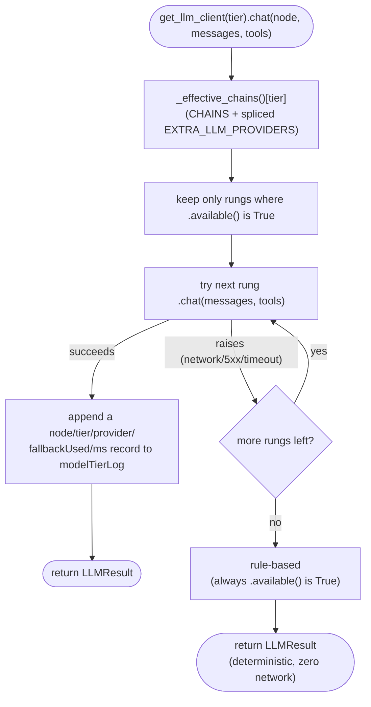
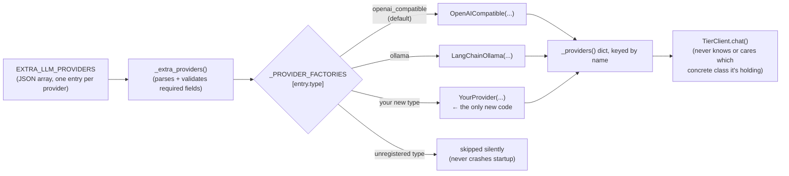

# Model provider architecture

How to add a model, in two different senses of "add" — a new hosted API
account, or a genuinely different kind of client library — without editing
the fallback-chain logic in `router.py` either way.

## The moving parts

```
providers.py
├── LLMProvider           Protocol — {name, available(), chat()}. The only
│                          contract TierClient relies on (see router.py).
│                          Every provider below satisfies it structurally;
│                          nothing needs to inherit from anything.
├── OpenAICompatible       One class, N configs — Luna, Max, Deepseek, Groq,
│                          Algo Engine,  (github.com/JustVugg/
│                          — a local MoE inference engine; `./coli serve` is
│                          OpenAI-compatible, so no new class), and every
│                          EXTRA_LLM_PROVIDERS entry with type
│                          "openai_compatible" (the default) are all this
│                          same class with different base_url/api_key/model.
├── LangChainOllama        A genuinely different client library — LangChain's
│                          ChatOllama, .bind_tools()/.invoke()/.tool_calls,
│                          not another raw httpx POST wearing a new name.
│                          The "add an SLM" (small local model) tier.
└── RuleBased              The deterministic offline floor every chain ends
                           on — zero dependencies, zero network calls.

router.py
├── _PROVIDER_FACTORIES    "type" string → factory(config) -> LLMProvider.
│                          Add a new provider *kind* by adding one entry
│                          here (Open/Closed) — see "Adding a new provider
│                          kind" below.
├── _providers()           The five named tiers (luna/max/deepseek/groq/
│                          algo-engine/ollama) plus every EXTRA_LLM_
│                          PROVIDERS entry, keyed by name.
├── CHAINS                 The fixed default fallback order per tier.
├── _effective_chains()    CHAINS with EXTRA_LLM_PROVIDERS entries spliced
│                          into whichever tier(s) they name, always just
│                          before "rule" (the floor never moves).
└── TierClient.chat()      Walks _effective_chains()[tier], skipping any
                           rung whose .available() is False, trying each in
                           order until one doesn't raise.
```

## How a call actually walks the chain

`TierClient.chat()` — one tier, one call, first rung that doesn't raise wins:



The rule-based floor is unconditionally the last rung in every default
chain (see `CHAINS`), so this can never fall off the end — worst case, every
hosted provider and every configured SLM is down or unset, and the
deterministic parser still answers.

## Adding a new hosted API — config only, no code

Any OpenAI-compatible endpoint (OpenRouter, Together, Anyscale, a second
self-hosted vLLM, ...) is one `EXTRA_LLM_PROVIDERS` entry:

```bash
EXTRA_LLM_PROVIDERS=[{
  "name": "openrouter",
  "base_url": "https://openrouter.ai/api/v1",
  "api_key": "sk-or-...",
  "model": "meta-llama/llama-3.3-70b-instruct",
  "tiers": ["realtime"]
}]
```

- `tiers` picks which chain(s) it joins — omit it to join all three.
- It's inserted just before `"rule"` in each chain it joins, so it's always
  tried before the deterministic floor but never displaces the tiers already
  ahead of it.
- Malformed JSON, or an entry missing `name`/`base_url`, is skipped silently
  (this is optional config — a typo shouldn't take the bot down). See
  `tests/test_retrieval_and_router.py`'s `test_extra_llm_providers_*` tests.

## Adding a local SLM (small language model) via Ollama

```bash
pip install langchain-ollama   # optional dependency, requirements.txt
ollama serve                    # separately, on the same or another host
ollama pull llama3.2:1b

OLLAMA_BASE_URL=http://localhost:11434
OLLAMA_MODEL=llama3.2:1b
```

That's it — `ollama` is always a rung in the `realtime`/`bulk` chains (see
`CHAINS` in `router.py`); with no `OLLAMA_BASE_URL` it's just unavailable,
same as Luna/Max/Deepseek/Groq with no key set. This is real LangChain
(`ChatOllama`, `.bind_tools()`, reads `.tool_calls` off the response) —
genuinely offline inference, no API key, runs on a laptop.

You can also point a *second* Ollama instance (or any Ollama-compatible
server) at a different tier via `EXTRA_LLM_PROVIDERS` with `"type": "ollama"`:

```bash
EXTRA_LLM_PROVIDERS=[{
  "name": "team-slm", "type": "ollama",
  "base_url": "http://gpu-box:11434", "model": "phi3:mini",
  "tiers": ["bulk"]
}]
```

## Adding a new provider *kind* (not just a new host)

Say you want a native Bedrock or Anthropic client instead of an
OpenAI-compatible shim. Two steps, both in `providers.py`/`router.py`, never
in `_extra_providers()`'s parsing/validation logic itself:

1. Write the class in `providers.py`. It just needs `name: str`,
   `available() -> bool`, and `chat(messages, tools=None) -> LLMResult` —
   satisfy `LLMProvider` structurally, no base class to extend.
2. Register it in `router.py`'s `_PROVIDER_FACTORIES`:
   ```python
   _PROVIDER_FACTORIES["bedrock"] = lambda e: BedrockProvider(
       e["name"], e.get("region", "us-east-1"), e.get("model", ""))
   ```

Now `{"name": "claude-on-bedrock", "type": "bedrock", "base_url": "-",
"region": "us-west-2", "model": "anthropic.claude-3"}` in
`EXTRA_LLM_PROVIDERS` works, with zero changes to the chain-walking or
config-parsing code — that's the Open/Closed point: `_extra_providers()` and
`TierClient.chat()` are closed for modification, `_PROVIDER_FACTORIES` is
open for extension.



## Why a Protocol instead of an ABC

`LLMProvider` is a `typing.Protocol`, not an abstract base class, because
every provider here is already a plain `@dataclass` with no need for shared
base-class behavior (no template methods, no shared state) — structural
typing gets the Liskov-substitutability guarantee (anything with the right
three members works anywhere a provider is expected) without forcing an
inheritance relationship that would only exist to satisfy the type checker.
`test_every_registered_provider_satisfies_the_llm_provider_protocol` in
`tests/test_retrieval_and_router.py` checks this holds for whatever
`_providers()` actually returns, including config-constructed ones.
